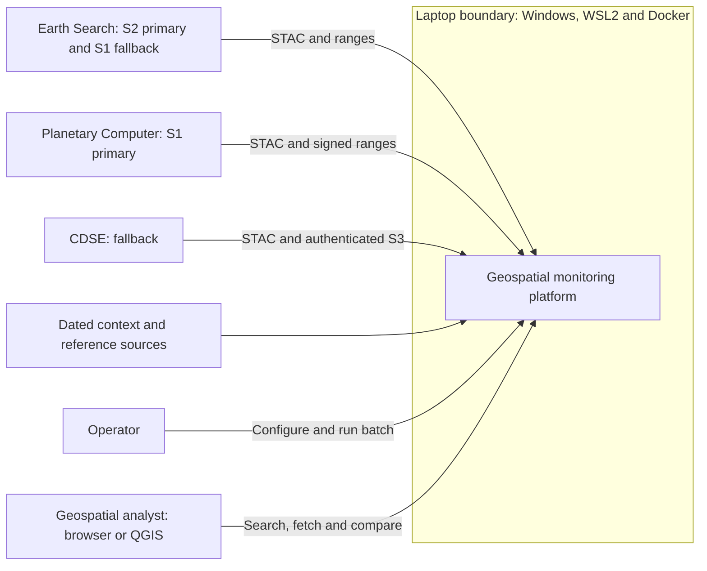
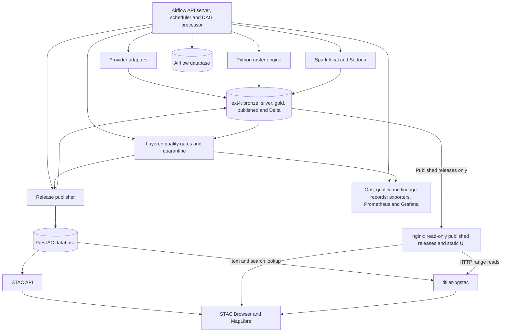
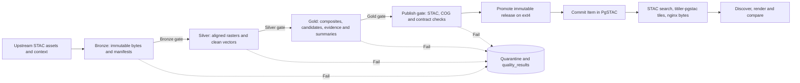
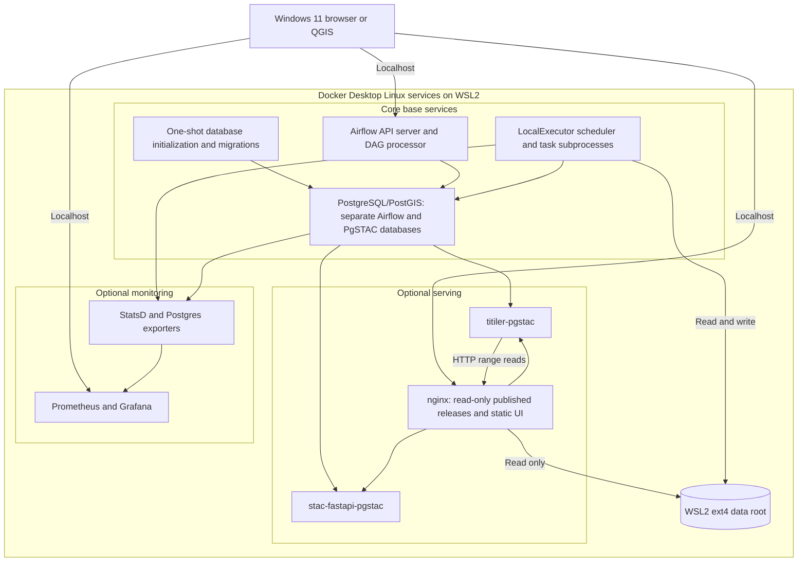

# Solution and Data Architecture

- Stage: 05 — Solution and data architecture
- Date: 2026-11-25
- Status: Accepted by the user on 2026-11-25, including the post-review revision (ADRs 0027–0032). See [project state](project-state.md).
- Inputs: [requirements](requirements.md), [measurement specification](measurement-spec.md), [source register](source-register.md), [feasibility pilot](feasibility-pilot.md), [domain glossary](domain-glossary.md), and the [decision index](decisions/README.md).

## Context and quality attributes

The laptop-hosted platform lets one geospatial analyst discover, compare and interpret **candidate** urban-expansion and vegetation-change products. It is not a real-time alerting or ground-truth service. Water extent, coastal change and multi-year environmental indicators remain deferred, in that order. The approved footprint is the Abu Dhabi corridor and Al Ain patch, processed at EPSG:32640 / 10 m as separate parts (not one large enclosing rectangle). Process Dec–Feb anniversary windows from 2019/20 to 2025/26 with the 2021/22 Dec-only exception explicitly flagged. Stage 04 was a go **with waivers**: retain the desert control drift and urban gate miss in product limitations; neither is evidence of analytical validation.

Prioritize repeatable inputs, recoverable window-sized tasks, reachable published assets, evidence alongside candidate signals, and bounded resource use. Distinguish processing freshness from detection latency: persistence requires consecutive comparable windows, and the annual cadence implies a multi-year wait. Scope, criteria and non-goals come from [Stages 01–04](project-state.md).

## Layer semantics

| Layer | Contains | Grid and format | Mutability | Consumers |
| --- | --- | --- | --- | --- |
| Bronze | Acquired upstream bytes: AOI-window subsets in their native grid and CRS (S2 COG windows; S1 GRD windows with calibration and noise XML), dated context files, and one acquisition manifest per upstream item (STAC Item copy, provider, sanitized href, checksum, bytes, access time). | Native grid; GeoTIFF/COG, XML, source formats | Immutable, append-only | Silver jobs, lineage, replay |
| Silver | Per-date analysis-ready rasters on EPSG:32640 at 10 m (S2 NDVI/SAVI with masks; S1 σ⁰ VV/VH in dB), clean vectors (AOI, dated OSM extract) and reprojected context rasters (GHSL, WorldCover). | COG; Delta (WKB + bbox) | Replaced only by a new run version | Gold jobs |
| Gold | Analyst-facing products: per-window composites with valid-observation count and variability, Δ against the baseline, persistence k of N, confidence class, candidate polygons, coverage and aggregate tables. | COG; internal Delta tables; open exports | Immutable per release | Quality gates, publisher |
| Published | Promoted gold releases whose Items are committed in PgSTAC. | As gold | Immutable | Analysts |
| Ops, quality and lineage | Run manifests, `quality_results`, lineage tables, OpenLineage event files, quarantine records. | Delta, JSON | Append-only | Operator; Stages 14, 16, 17, 19 |

## Component responsibilities and limits

| Component / layer | Responsibility and limit | Implementation owner |
| --- | --- | --- |
| Provider adapters and bronze | Query upstream STAC and freeze approved input selection. Persist immutable native-grid subsets, originals where required, acquisition metadata, S1 calibration/noise XML, and checksums of the bytes actually retained. A subset is not a full-scene original: keep source identifiers, crop offsets and georeferencing/LUT context. Sanitize upstream hrefs; do not retain ephemeral signing parameters. | 09 |
| Python/rasterio/GDAL/NumPy and silver | Read bounded raster blocks; warp, calibrate, mask and persist per-date analysis-ready rasters, including S2 reflectance/NDVI/SAVI and S1 sigma-nought VV/VH. Preserve valid-data masks and grid metadata. Check the S1 GCP-only warp defect with regression evidence; a crop must preserve the correct source GCP and LUT coordinates. | 10 |
| Spark local / Sedona and Delta | Clean and join vectors, process zonal-summary rows, and incrementally maintain tabular outputs. Python extracts raster zonal values and polygonizes; Spark handles joins and aggregation on those features/rows. Store WKB and bbox in Delta, preserve CRS, and export analyst-facing geometry as GeoParquet 1.1. GHSL is raster context, not a clean vector layer or signal input; OSM context remains separate from signal products. Spark does **not** read or write pixels, orchestrate tasks or serve analysts. | 11 |
| Gold generation | Create window composites, change candidates, coverage/variability evidence, persistence and confidence outputs, polygons and summaries. Publish COG assets and open table exports, not internal Delta paths. Stage 12 owns methods and thresholds, including reference selection and confidence rules. | 12 |
| Airflow and shared PostgreSQL/PostGIS | Airflow 3.4 LocalExecutor schedules windows and manages task dependencies, retries and recovery. Airflow does **not** implement analytics, pass datasets through XCom, store products or set quality thresholds. PostgreSQL hosts separate Airflow and PgSTAC databases/roles; neither is the primary raster or analytical table store. | 08 (runtime), 13 (DAGs) |
| Quality gates and release publisher | Run the layered quality gates (see [Data quality](#data-quality)), quarantine failures, and coordinate immutable asset promotion, committed table snapshots and transactional STAC indexing. Publication is not a quality substitute. | 13 (publisher), 14 (gates) |
| Local STAC API, tiles, asset server and viewer | PgSTAC backs stac-fastapi-pgstac, the catalog of published data products. titiler-pgstac renders tiles for Items and searches resolved through PgSTAC, so only indexed releases render. nginx serves the promoted release directory read-only with HTTP range support and hosts STAC Browser and a small MapLibre comparison page. The STAC API does **not** serve pixels, hold full lineage or decide publication; the tiler does **not** catalogue or recompute indicators. | 15 |
| Operational evidence and lineage | Record logs, run manifests, Delta ops, lineage and quality records, and OpenLineage event files. Optional Prometheus, Grafana, StatsD and Postgres exporters make trends visible. Ops logging is not the publication authority. | 16 (ops), 06/07/17 (lineage) |
| Trust boundaries | External provider access; local task/DB writers; read-only analyst services; separate context/licence domains. Keep upstream access secrets in the ingestion boundary and off the analyst path. | 07 (design), 17 (verification) |

Raster work is dense, grid-aligned array processing; windowed GDAL I/O keeps the working set bounded without turning pixels into Spark rows. A **Cloud-Optimized GeoTIFF (COG)** uses internal tiles, ordered metadata and, where useful, overviews so HTTP range reads can fetch relevant bytes without downloading the full raster. Retain original non-COG inputs where conversion would lose required semantics; derived raster assets target COG, and native-grid subset packaging must pass the Stage 09 replay check. Spark `local` demonstrates partitions, joins and incremental tables on one laptop. It provides no evidence of distributed-scale performance.

## Interfaces and error paths

- **Discovery/acquisition:** bbox/time and approved provider rules yield a frozen input manifest. S2: Earth Search Collection-1, CDSE fallback; S1 GRD: Planetary Computer, then Earth Search, then CDSE. The approved Dec-only window is not automatically filled. Bound downloads, retry transient failures/429 with backoff, renew expired signatures, and verify fallback equivalence and volume before use. Record source gaps and fail or gate the product rather than presenting missing observations as unchanged.
- **Processing:** tasks pass small identifiers and manifest/asset references, not raster arrays. Validate input integrity and grids, fail on bad transforms or invalid shape, and retain enough lineage to rerun from bronze or completed silver. Persistent failures or quality failures produce actionable status and remain unpublished. Stage 06 defines detailed contracts, keys and metadata.
- **Analyst access:** local STAC returns searchable metadata and durable browser/QGIS-facing asset hrefs. Tile requests go through titiler-pgstac by Item or search, so they resolve only indexed releases. Browser comparison shows the signal, valid-observation coverage, uncertainty and contextual evidence. Keep staging, quarantine, internal paths and upstream credentials outside this boundary. GHSL and OSM are context only; redistribution/attribution and access policy go to Stage 07.

## Publication consistency

There is **no** cross-system transaction spanning Delta, ext4 and PgSTAC. Use a recoverable, ordered release with a single publisher per logical product. **STAC visibility is the publication boundary:** a release is published when, and only when, its Item is committed in PgSTAC ([ADR 0027](decisions/0027-stac-visibility-publication-boundary.md)).

1. Freeze a release identity from product scope and the canonical inputs/configuration, including algorithm and contract versions. Stage 06 defines exact keys. Same inputs and configuration produce the same identity. Write output to a non-served staging directory on the same filesystem as the release destination. Commit any needed Delta inputs/outputs before building exports from **pinned versions**, and record those versions and asset checksums in the release manifest. Run the publish quality gate (STAC, COG and contract validation) before promotion.
2. Atomically rename the complete staged directory into its versioned destination under the published root, or reuse it only if the existing checksums match. Never overwrite in place; a mismatch is a release conflict, not a success.
3. Upsert the deterministic Item ID in a PgSTAC transaction **after** the files are ready. Previously indexed revisions and their hrefs stay valid; a new release never replaces bytes under an existing href.
4. Failure states:
   - Before rename: only staging exists; a retry rebuilds or reuses it.
   - After rename, before catalogue commit: an **orphan release**. It is complete and checksummed but not discoverable and not renderable, because titiler-pgstac resolves only indexed Items. nginx could return its bytes to someone who guesses the path; this is accepted because the bytes are complete and validated. The retry indexes it.
   - After commit, before task acknowledgement: a valid published release; the retry is a no-op.

A reconciliation task compares release manifests, the published root and PgSTAC, then indexes or reports orphans and reports missing files. Automatic retries never delete referenced assets or pinned snapshots. Stages 13–14 and 19 verify crash points, checksums and duplicate-free reruns.

## Data quality

Layered gates ([ADR 0032](decisions/0032-layered-quality-gates.md)). Error-severity failures block the downstream step and move the artefact to a quarantine area with its result record. Warning-severity results are recorded and surfaced but do not block. Every result is appended to a Delta `quality_results` table keyed by `run_id`, layer, dataset and check, and gold summaries are copied into STAC Item properties so analysts see them.

| Gate | Example checks (Stage 14 sets the final list and thresholds) |
| --- | --- |
| Bronze | Checksum matches the manifest; file opens; CRS present (S2) or GCPs plus calibration and noise LUTs present (S1); footprint covers the AOI part; byte count within the expected range. |
| Silver | Grid equals EPSG:32640 10 m target; reflectance and σ⁰ in physical ranges; valid-pixel and mask fractions recorded; no constant-array output (regression check for the S1 warp defect R6). |
| Gold | Valid-observation coverage of the AOI (AC-05); control-site drift against Stage 12 thresholds (R1); observation-count and variability ranges; persistence k ≤ N; the reduced 2021/22 window flagged. |
| Publish | STAC Item validates against the core spec and declared extensions; COGs validate; tabular exports pass their ODCS contract tests. |

Stage 14 selects the library. The shortlist is GX Core (Apache-2.0) and pandera (MIT); Soda Core is flagged because a secondary source reports it moved to the Elastic Licence 2.0. Raster checks use rasterio and COG validation rather than a dataframe framework. Quality gates evaluate pipeline and data integrity; they are not analytical validation (AC-04).

## Lineage

Built-in lineage with no extra service ([ADR 0029](decisions/0029-built-in-lineage.md)):

- **Run manifests and Delta lineage tables:** `run_id`, DAG and task, code version (Git commit), configuration hash, input upstream Item IDs with checksums, output artefacts and their checksums. Every silver and gold artefact links to its inputs by ID, so a gold record traces back to bronze assets (the Stage 17 and 19 lineage query).
- **Published STAC Items:** the processing extension (`processing:software`, `processing:lineage`, `processing:datetime`) and `derived_from` links to the upstream source Items, plus the `run_id`.
- **OpenLineage events:** Airflow's OpenLineage provider writes standard run events to a file transport in the ops area, so a lineage server such as Marquez could ingest them later without code changes. Spark OpenLineage support for Spark 4.1 is unverified and optional; Stage 08 checks it.

Stage 06 defines the lineage fields and keys; Stage 07 sets the retention and reproducibility rules.

## Data catalog and data products

- **Catalog:** the local STAC API over PgSTAC is the catalog of published data products ([ADR 0030](decisions/0030-stac-as-product-catalog.md)). Internal bronze, silver and Delta datasets are described by versioned contracts in the repository and a generated dataset reference page; there is no separate catalog service. OpenMetadata's documented minimum (16 GiB for the server alone) exceeds the 15.5 GB Docker VM.
- **Data products** ([ADR 0031](decisions/0031-data-products-and-contracts.md)): each MVP capability is one data product, *candidate urban expansion* and *vegetation change*, published as one STAC Collection each. Every product has:
  - an **ODPS v1.1** descriptor: owner, purpose, output ports (STAC Collection, COG assets, vector and table exports), licence and attribution, limitations and the cannot-claim statements from the [measurement spec](measurement-spec.md);
  - an **ODCS v3.2** contract for each tabular or vector output, tested with datacontract-cli in CI and at the publish gate;
  - a raster specification through STAC `item_assets` with the raster, proj, file and processing extensions, plus COG validation, because ODCS does not describe rasters.
- **Vector delivery to the map:** MapLibre cannot read GeoParquet directly. Stages 06 and 15 choose an additional map-ready export, such as FlatGeobuf or GeoJSON served by nginx, or PMTiles. Serving vectors from PostGIS with tipg is an alternative that would add a service.

## Resource envelopes and deployment profiles

**Measured** on Windows 11 / Docker Desktop WSL2 (2026-11-24, `docker info`, pilot process RSS): Docker VM 15.5 GB RAM and 8 vCPU; peak pilot process RSS 1.48 GB. **Approved budgets** ([ADR 0012](decisions/0012-laptop-constraints-and-data-budgets.md)): ≤50 GB full-scope source downloads, ≤100 GB project disk, ≤60 minutes per job. Stage 04 **estimated** about 8 GB download and 11.3 GB data disk against its scope; those estimates exclude images, infrastructure and complete gold assets. Native-grid retention, retries, fallback downloads, temporary files, Delta history, monitoring retention and image layers must be included in the Stage 08/18 validation. The pilot I/O timing is not an end-to-end job SLA.

| Profile or combination | RAM planning estimate | Basis |
| --- | ---: | --- |
| Core | 7.8 GB | Postgres 0.4, Airflow API 0.6, scheduler overhead 0.5, DAG processor 0.3; task headroom 6.0 (Spark up to 4 incl. JVM/Python overhead as a sizing target, raster up to 2). |
| Serving add-on | +1.35 GB | STAC API 0.3, titiler-pgstac with capped GDAL cache 1.0, nginx static 0.05. |
| Monitoring add-on | +0.75 GB | Prometheus 0.4, Grafana 0.25, exporters 0.1. |
| Core + serving / core + monitoring | 9.15 / 8.55 GB | Add-ons require core. |
| All profiles | **9.9 GB** | Under the **12 GB aggregate container-limit target**, leaving at least 3.5 GB outside that target in the measured VM. |

Estimates are not container limits or measurements. Core is the base Compose service set; `serving` and `monitoring` are opt-in. Stages 08–14 can run with `core` only, and `serving` becomes routine from Stage 15. Lineage, catalog and data-product choices add no services. The scheduler's container budget includes task subprocesses and the JVM. Global Airflow parallelism 2 with Spark pool 1 and raster pool 2 bounds compute overlap; budget other heavy work against the same slots. Cap GDAL caches and concurrent tile requests. Treat init/migration as one-shot work, not concurrent with peak workloads. No probe in Stage 05. Stage 08 measures idle/loaded memory and verifies effective limits; if estimates do not hold, revisit the approved envelope before increasing concurrency or capacity. Stage 18 checks peak job duration, transfer and retained storage. Airflow's published Docker RAM guidance is for its Celery quick-start, not a measurement of this LocalExecutor stack.

## Requirements traceability

| Requirement | Component(s) and verification/handoff |
| --- | --- |
| BR-01, A-01 | STAC API, asset service and comparison UI; Stage 15 walks through discovery, comparison, coverage and context; Stage 20 documents it. |
| BR-02, BR-05 | Gold product generator and STAC collections distinguish urban/vegetation MVP from deferred capabilities; Stages 12 and 15. |
| BR-03, OQ-01 | Window configuration, source adapter and Airflow run manifests; Stages 08/09/13 and measured verification in 18/19. Freshness date remains unset. |
| BR-04, BR-06 | Gold evidence fields, quality gates and serving terminology limit claims; Stages 07/12/14/15/20. |
| AC-01 | Deterministic identity, staged assets, pinned Delta versions, unique PgSTAC Item upserts and reconciliation; rerun checks in 13/14/19. |
| AC-02 | Persistent checkpoints, Airflow retry, quarantine and release reconciliation; controlled failure/recovery evidence in 13/14/16/19. |
| AC-03 | Airflow timestamps and operational records; Stage 13 defines freshness with evidence from 16/18. |
| AC-04, OQ-02 | Gold reference-evaluation outputs and quality gates; Stage 12 defines evidence/metrics, Stage 14 verifies. |
| AC-05 | Silver observation masks, gold coverage and uncertainty, gold quality gate, `quality_results` summaries in STAC Items and the analyst evidence panel; Stages 10/12/14/15. |
| Lineage and reproducibility (Stage 06/07/17/19 prompts) | Run manifests, Delta lineage tables, STAC processing extension and `derived_from` links, OpenLineage event files. |
| Data products and contracts (Stage 06 prompt) | ODPS descriptors, ODCS contracts, STAC `item_assets`; tested with datacontract-cli and at the publish gate. |

## Component evidence and deferred options

Official project sources accessed 2026-11-25; version observations are not an integrated runtime test. Use Linux containers on the measured Docker Desktop/WSL2 backend; Stage 08 checks compatibility under the actual host, not native-Windows binaries. Select exact compatible pins from official support matrices, including PostgreSQL/PostGIS and the PgSTAC migration pair, before installing.

| Candidate | Verified evidence and compatibility boundary |
| --- | --- |
| Airflow | [3.4.0 release](https://airflow.apache.org/blog/airflow-3.4.0/) (Apache-2.0) provides an official Linux image and constraints. The [Compose quick-start](https://airflow.apache.org/docs/apache-airflow/stable/howto/docker-compose/index.html) is a Celery example, not the chosen shape. |
| Rasterio/GDAL | [Rasterio](https://github.com/rasterio/rasterio) (BSD-3-Clause) and [GDAL](https://gdal.org/) (MIT-style); Stage 04 measured rasterio 1.5.2 / GDAL 3.12.2 on Windows. The Linux-container package combination is to be pinned and smoke-tested in Stage 08. |
| Spark/Sedona | [Spark downloads](https://spark.apache.org/downloads.html), [Sedona 1.9.1](https://pypi.org/project/apache-sedona/) and [Sedona's platform matrix](https://sedona.apache.org/latest/setup/platform/): Apache-2.0, Spark 4.1 line, Scala 2.13 and Java 17 for the chosen pairing. Do not assume Spark 4.2 compatibility. |
| Tables | [Delta 4.x release evidence](https://delta.io/blog/2026-08-20-simplifying-your-open-lakehouse-with-the-delta-kernel-and-the-uc-delta-apis/) and [Iceberg spec](https://iceberg.apache.org/spec/) (Apache-2.0 projects). Delta 4.1+ is built on Spark 4.1 with Spark-suffixed artifacts such as `delta-spark_4.1_2.13` (secondary source). Use path-based Delta with WKB/bbox and [GeoParquet 1.1](https://geoparquet.org/releases/v1.1.0/) interchange; GeoParquet 2.0 exists but end-to-end reader/writer compatibility is not established. Verify Delta/Spark/Sedona jars and a read/write/MERGE/export in Stage 08. |
| Local STAC and tiles | [stac-fastapi-pgstac 7.4.0](https://pypi.org/project/stac-fastapi-pgstac/), [pypgstac 0.10.2](https://pypi.org/project/pypgstac/) and [titiler-pgstac 3.2.2](https://github.com/stac-utils/titiler-pgstac/releases) (2026-11-18) are MIT releases. The [eoAPI](https://github.com/developmentseed/eoAPI) reference stack (MIT) combines the same components and is a template for Stage 08. Presence of releases does not establish mutual compatibility. |
| Quality, lineage and contracts | [Airflow OpenLineage provider 2.21.1](https://airflow.apache.org/docs/apache-airflow-providers-openlineage/stable/index.html); [STAC processing extension](https://github.com/stac-extensions/processing); [ODCS v3.2 and ODPS v1.1](https://bitol.io/data-contracts-data-products-for-ai/) (Bitol, 2026-09-08); [datacontract-cli](https://github.com/datacontract/datacontract-cli) (MIT). GX Core and Soda licence status is from a secondary source; Stage 14 re-verifies. |
| Supporting services | [PostgreSQL](https://www.postgresql.org/support/versioning/) (PostgreSQL Licence), [PostGIS](https://postgis.net/) (GPL), [nginx](https://nginx.org/) (BSD-2-Clause), [STAC Browser](https://github.com/radiantearth/stac-browser) (Apache-2.0), [MapLibre GL JS](https://github.com/maplibre/maplibre-gl-js) (BSD-3-Clause), [Prometheus](https://prometheus.io/) and its exporters (Apache-2.0), [Grafana OSS](https://github.com/grafana/grafana) (AGPL-3.0). Exact versions, images and integrated Windows/WSL2 smoke checks are downstream gates. |
| S3 alternatives | [MinIO CE](https://github.com/minio/minio) is AGPL-3.0 and archived. [SeaweedFS](https://github.com/seaweedfs/seaweedfs) and [RustFS](https://github.com/rustfs/rustfs) are Apache-2.0 alternatives; no S3 compatibility or performance probe was run. |

Defer local S3, GeoParquet 2.0, Iceberg, Celery, native geometry table types, a Marquez lineage UI, a separate metadata catalog service, detailed security policies, and hosted/cloud deployment. URI-based interfaces reduce migration friction, but replacing the filesystem requires a new publication protocol: S3 does not supply same-filesystem directory rename. Stage 06 owns exact schemas and Stage 07 owns security controls; this document adds no infrastructure or code.

## Implementation feasibility and handoffs

All chosen components have current, maintained, permissively or copyleft-licensed releases (above). No component needs paid services, GPUs or Kubernetes. The remaining risks are integration risks, assigned here:

| Risk or handoff | Action | Owner |
| --- | --- | --- |
| One Python version across the Airflow 3.4 constraints, PySpark 4.1, Sedona 1.9, Delta and rasterio/GDAL wheels | Choose and pin a single Python version; Stage 04 used 3.13 on Windows. Fall back to Airflow 3.3.x if the constraints file conflicts. | 08 |
| Repository on NTFS (`C:\`) bind-mounted into Linux containers | Slow DAG parsing and no file-change events. Keep the working copy in the Ubuntu-24.04 WSL distro, or measure and accept the cost. | 08 |
| Data root location | Put it in the Ubuntu-24.04 distro, not Docker Desktop's own disk image, which "Reset to factory defaults" deletes. Bronze can be re-downloaded, but manifests and access times cannot. | 08 |
| Spark jars (Sedona, Delta) | Bake them into the image; no runtime Maven resolution. Smoke-test read, write, MERGE and GeoParquet export. | 08 |
| OpenLineage Spark listener on Spark 4.1 | Optional; enable only if verified. | 08 |
| S2 loading across the four-tile MGRS junction (R5) | Evaluate [odc-stac](https://github.com/opendatacube/odc-stac) (Apache-2.0) for S2 reprojection and mosaicking instead of custom code; S1 keeps the custom GCP path. | 10 |
| Map-ready vector export | Choose FlatGeobuf, GeoJSON or PMTiles alongside GeoParquet. | 06, 15 |
| Tile reads through nginx | titiler-pgstac reads the same HTTP hrefs analysts use. If the extra hop matters, Stage 15 may add file hrefs through the alternate-assets extension. | 15 |
| Workload against under 5 h/week (R13) | Run `core` only until Stage 15; monitoring stays optional. | 08–15 |
