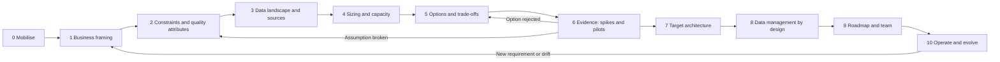
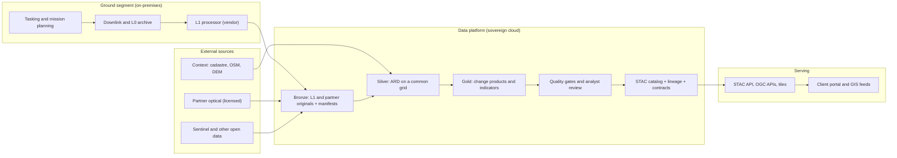
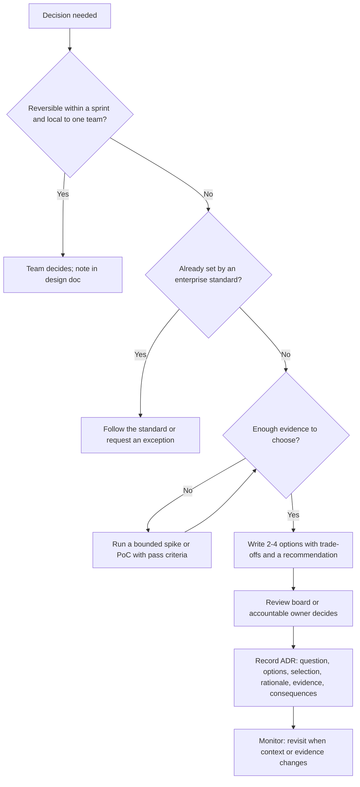
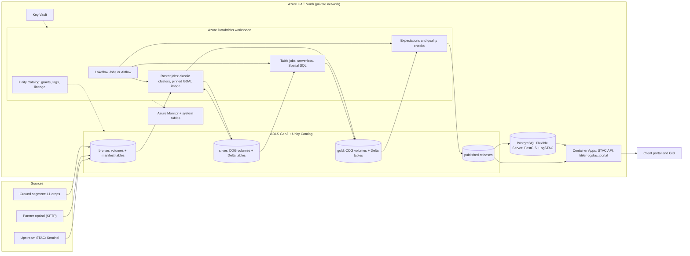

# Data Architecture Playbook: Designing a Data Platform in an Earth-Observation Company

- Purpose: a step-by-step, practical method for designing the data architecture of a real project, written for a data architect in an Earth-observation (EO) or geospatial company in the UAE.
- Audience: an experienced data engineer moving into a data-architect role who is new to the EO domain.
- Companion documents: [domain knowledge handbook](domain-knowledge.md) (domain concepts and enterprise lens), [architecture](architecture.md) (this project's approved design), [decision records](decisions/README.md). For an Azure + Databricks translation with interview questions, see [§20](#20-azure-and-databricks-reference-implementation).
- Date: 2026-11-25.

> **Boundary and honesty note.**
> - The running case study, **"Falcon Earth Intelligence" (FEI)**, is **fictional**. Its customers, satellites, numbers, budgets, incidents and people are **mock data** invented for teaching.
> - Companies such as **Space42** or **MBRSC** appear only through the public facts already cited in the [domain knowledge handbook §8.1](domain-knowledge.md#81-public-context-verified-accessed-2026-11-24). Nothing here describes their internal architecture, tools, processes or decisions, and the project claims no endorsement.
> - Prices, sizes and timings are **illustrative placeholders**, not quotes. Regulations are named as **things to check with legal and compliance**, not as legal advice.
> - Labels: **real example** (from this repository, with a link), **mock** (fictional), **industry practice** (general, unverified for any specific company).

---

## Contents

1. [What a data architect actually owns](#1-what-a-data-architect-actually-owns)
2. [The case study: FEI and the "Coastal Cities Change Service"](#2-the-case-study-fei-and-the-coastal-cities-change-service)
3. [The method at a glance](#3-the-method-at-a-glance)
4. [Phase 0: Mobilise](#4-phase-0-mobilise)
5. [Phase 1: Business framing](#5-phase-1-business-framing)
6. [Phase 2: Constraints and quality attributes](#6-phase-2-constraints-and-quality-attributes)
7. [Phase 3: Data landscape and source assessment](#7-phase-3-data-landscape-and-source-assessment)
8. [Phase 4: Sizing and capacity model](#8-phase-4-sizing-and-capacity-model)
9. [Phase 5: Options and trade-off analysis](#9-phase-5-options-and-trade-off-analysis)
10. [Phase 6: Evidence: spikes, PoCs and pilots](#10-phase-6-evidence-spikes-pocs-and-pilots)
11. [Phase 7: Target architecture design](#11-phase-7-target-architecture-design)
12. [Phase 8: Data management by design](#12-phase-8-data-management-by-design)
13. [Phase 9: Delivery roadmap and team](#13-phase-9-delivery-roadmap-and-team)
14. [Phase 10: Operate, measure and evolve](#14-phase-10-operate-measure-and-evolve)
15. [How decisions should be made](#15-how-decisions-should-be-made)
16. [Real-world limitations: twelve mock scenarios](#16-real-world-limitations-twelve-mock-scenarios)
17. [From this laptop project to an enterprise platform](#17-from-this-laptop-project-to-an-enterprise-platform)
18. [Anti-patterns](#18-anti-patterns)
19. [Checklists and templates](#19-checklists-and-templates)
20. [Azure and Databricks reference implementation](#20-azure-and-databricks-reference-implementation)
21. [References](#21-references)

---

## 1. What a data architect actually owns

A data architect is accountable for **the shape of the data and the decisions that are expensive to change later**. You are not the person who writes most of the code, and you are not the person who decides the business priorities. You sit between them and make the trade-offs explicit.

### 1.1 Owns, contributes, does not own

| The data architect **owns** | **Contributes to** (others own) | Does **not** own |
| --- | --- | --- |
| Layer semantics (what bronze/silver/gold mean) | Business case and priorities (product owner) | Day-to-day pipeline code (data engineers) |
| Storage, table and file formats; partitioning | Security controls (security architect) | Algorithm science, thresholds, accuracy (EO scientists, Cal/Val) |
| Data models, keys, identifiers, contracts | Infrastructure and networking (platform/cloud team) | Contract negotiation with suppliers (procurement, legal) |
| Lineage, metadata and catalog design | Cost budget (finance/FinOps) | Running production on-call (SRE/operations) |
| Publication and consistency rules | Regulatory interpretation (legal/compliance) | UI design (product designers) |
| Non-functional requirements for data: freshness, retention, recovery | Team structure (engineering manager) | |
| Architecture decision records (ADRs) and the decision log | | |

### 1.2 Deliverables a real architect produces

| Deliverable | Audience | This project's equivalent (**real example**) |
| --- | --- | --- |
| Problem statement and context diagram | Executives, product | [Requirements](requirements.md), [architecture context](architecture.md#context-and-quality-attributes) |
| Quality-attribute scenarios and NFR register | Engineering leads, operations | [Requirements](requirements.md) AC-01–AC-05 |
| Source register and profiling report | Engineers, legal | [Source register](source-register.md), [profiling report](profiling-report.md) |
| Sizing and cost model | Finance, platform team | [Feasibility pilot §6](feasibility-pilot.md#6-scaling-estimates-full-p1-scope) |
| Options analysis and ADRs | Architecture review board | [ADRs 0016–0032](decisions/README.md) |
| Target architecture (C4 or arc42 style) | Everyone | [Architecture](architecture.md) |
| Data models and contracts | Engineers, consumers | Stage 06 (not yet written) |
| Governance and security design | Security, compliance | Stage 07 (not yet written) |
| Roadmap and transition plan | Programme management | [Project state](project-state.md) stage plan |
| Fitness functions and review cadence | Operations, architecture board | Stages 14, 16, 18 |

### 1.3 The three questions behind every decision

1. **What does it cost to be wrong?** Reversible ("two-way door") decisions should be made quickly by the team. Irreversible ("one-way door") decisions need evidence and a formal record.
2. **What evidence would change my mind?** If no evidence could change the choice, you are not deciding; you are rationalising.
3. **Who has to live with it?** The people who will operate, pay for and consume the result must be consulted before the decision, not informed after it.

---

## 2. The case study: FEI and the "Coastal Cities Change Service"

All of this section is **mock**.

**Falcon Earth Intelligence (FEI)** is a fictional Abu Dhabi company with about 400 staff. It operates:

- **4 SAR satellites** (X-band, own design, launched 2023–2026) and access to a partner's optical constellation under a **commercial licence**.
- An **own ground segment**: two ground stations, an L0→L1 processor written in C++ by a vendor ten years ago, and an Oracle database that tracks acquisitions.
- An analytics team using a desktop GIS, Python notebooks and a shared network drive.
- A customer portal (ArcGIS-style web maps) hosted in an on-premises data centre.

**The project.** A government planning authority ("the Client") signs a three-year contract for a **Coastal Cities Change Service**:

| Contract item (**mock**) | Requirement |
| --- | --- |
| Product A: Construction monitoring | Monthly change map of new construction across 4 coastal cities (about 3,500 km² in total) |
| Product B: Shoreline and reclamation | Quarterly shoreline position and reclaimed-land extent |
| Product C: Emergency response | On request, a flood or damage map within **6 hours** of the client's request |
| Delivery | Web portal, OGC map services for the client's GIS, and a quarterly PDF report |
| Data handling | Client data classified as "Confidential – Government"; must stay in the UAE |
| Accuracy | "≥ 85 % accuracy" (the Client's wording; see §5.4 for why this is not yet a requirement) |
| Budget | Fixed price; the platform part has a mock budget of AED 6 million over three years, including staff |
| Timeline | First monthly product due **5 months** after signature |

**What makes it realistic.**

- The deadline is fixed, but the requirements are vague.
- Three data sources come with three different licences.
- A legacy stack must keep working throughout.
- A government security classification applies.
- The team is small: 1 architect, 4 data engineers, 3 EO scientists, 1 platform engineer and a shared security team.
- Sales has already promised "near real-time".

---

## 3. The method at a glance

The phases are **iterative, not a waterfall**. You loop back when evidence contradicts an assumption, which is exactly what happened in this project when the Stage 04 pilot failed two gates ([ADR 0015](decisions/0015-feasibility-pilot-gates-and-outcome.md)).



| Phase | Key question | Main output | Typical duration in a real 5-month project (**mock**) |
| --- | --- | --- | --- |
| 0 Mobilise | Who decides what, and how? | Decision rights, RACI, cadence | 1 week |
| 1 Business framing | What problem, for whom, worth how much? | Use cases, product definitions, success measures | 1–2 weeks |
| 2 Constraints | What must be true, and what can't we change? | NFR register, constraint register | 1–2 weeks (overlaps 1) |
| 3 Data landscape | What data exists, and can we legally use it? | Source register, profiling report | 2–3 weeks |
| 4 Sizing | How big, fast and expensive? | Capacity and cost model | 1 week |
| 5 Options | What are the realistic alternatives? | Options analysis, draft ADRs | 1–2 weeks |
| 6 Evidence | Which assumptions are false? | Spike and pilot reports | 2–4 weeks |
| 7 Target architecture | What will we build? | Architecture document, diagrams | 1–2 weeks |
| 8 Data management | How is data trusted, governed and secured? | Models, contracts, lineage, quality, security design | 2–3 weeks (overlaps 7) |
| 9 Roadmap | In what order, and by whom? | Release plan, team topology | 1 week |
| 10 Operate | Is it still fit for purpose? | Fitness functions, reviews | Continuous |

The total is longer than 5 months if done serially. In practice phases 3–8 overlap, and the first thin slice (§13.2) starts in parallel with phase 7.

---

## 4. Phase 0: Mobilise

**Goal:** agree how decisions will be made *before* the first contentious decision arrives.

### 4.1 Activities

1. **Map the stakeholders and their stakes**: who pays, who uses, who operates, who can say no.
2. **Agree decision rights** using a RACI per decision category (table below).
3. **Set a cadence**: a weekly architecture sync with engineering leads, and a fortnightly review board for one-way-door decisions.
4. **Create the decision log** (the ADR folder) and the risk register on day one.
5. **Find the existing standards**: enterprise reference architecture, approved technology list, security baseline and naming conventions. Ignoring them costs weeks later.

### 4.2 Mock RACI for FEI

R = responsible, A = accountable, C = consulted, I = informed.

| Decision category | Architect | Product owner | Eng. lead | Security | Platform | EO science | Legal | CTO / review board |
| --- | --- | --- | --- | --- | --- | --- | --- | --- |
| Product scope and priority | C | **A/R** | C | I | I | C | I | I |
| Layer semantics, formats, models | **A/R** | I | C | I | C | C | I | I |
| Cloud versus on-premises hosting | R | C | C | C | C | I | C | **A** |
| Data classification and residency | C | C | I | **A/R** | C | I | C | I |
| Supplier data licence terms | C | C | I | I | I | I | **A/R** | I |
| Algorithm and thresholds | C | C | I | I | I | **A/R** | I | I |
| Accuracy claims to the client | C | **A** | I | I | I | R | C | I |
| Technology outside the approved list | R | I | C | C | C | I | I | **A** |

**Practical tip:** the most common source of rework is a decision that someone believed they owned and someone else overrode. Write the RACI down and get the CTO to sign it.

### 4.3 How this project did it (**real example**)

The [workflow contract](../.github/instructions/geospatial-workflow.instructions.md) is a one-person RACI: the user makes every material decision, the agent proposes options, and every approved decision becomes an ADR.

---

## 5. Phase 1: Business framing

**Goal:** turn the contract wording into precise, testable product definitions.

### 5.1 Questions to ask (and why)

| Question | Why it matters for data architecture |
| --- | --- |
| Who are the users, and what decision will they make with the product? | It determines grain, latency and the serving pattern. A planner deciding where to send an inspector needs a ranked list of sites, not a raster. |
| What happens if the product is late, wrong or missing? | It sets the SLA and recovery targets and how much redundancy is worth paying for. |
| Which products are recurring, and which are on demand? | Recurring products suit batch pipelines; on-demand ones need tasking, queues and priority lanes. |
| What is the minimum unit of value? | It defines the first thin slice (§13.2). |
| How will success be measured, and by whom? | It turns "accuracy" into a measurable acceptance test (§5.4). |
| What must the product never claim? | It sets the "cannot claim" rules. This project's example is the [measurement spec](measurement-spec.md). |

### 5.2 Use-case cards (**mock**)

| Field | Product A: Construction monitoring | Product C: Emergency response |
| --- | --- | --- |
| Actor | Client planning inspector | Client crisis desk |
| Trigger | Monthly schedule | Phone or email request |
| Decision supported | Which sites to inspect this month | Where to send teams |
| Output | Ranked change polygons with confidence; web map; GIS feed | Flood extent polygons and a damage-grade grid |
| Freshness needed | Within 10 days of month end | Within 6 hours of the request |
| Cost of being wrong | Wasted inspection visit | Teams sent to the wrong area |
| Cannot claim | Permit violation, building use, completion date | Exact water depth; damage cost |

### 5.3 Separate products from capabilities

A common mistake is to design one pipeline per contract line. Instead, identify the **shared capabilities** (acquisition, ARD production, change detection, publication) and the **product-specific logic** on top. In this project the MVP products share bronze, silver, the publisher and the STAC catalog, and differ only in gold logic ([ADR 0031](decisions/0031-data-products-and-contracts.md)).

### 5.4 Turning "≥ 85 % accuracy" into a requirement

"85 % accuracy" is not testable until you define:

1. **The metric.** Overall accuracy is misleading when change is rare: if 2 % of the area changes, a map that says "no change everywhere" is 98 % accurate. Use per-class precision and recall, or F1, with area-weighted estimates.
2. **The reference.** What counts as truth: field visits, VHR interpretation or the client's permit database? Each has its own errors and licence rules.
3. **The sample design.** Stratified random sampling, with sample sizes that give a stated confidence interval.
4. **The conditions.** Accuracy holds only above a minimum valid-observation coverage and a minimum mapping unit.
5. **The consequence.** What happens if one month misses the target?

This is exactly the split this project made between reliability (AC-01–03) and analytical criteria (AC-04–05) in [ADR 0003](decisions/0003-acceptance-target-frameworks-and-non-goals.md). **Practical tip:** get the metric definition into a contract annex *before* signature if you can. After signature, you negotiate from a weak position.

---

## 6. Phase 2: Constraints and quality attributes

**Goal:** find the things you cannot change, and turn "fast, reliable, secure" into measurable scenarios.

### 6.1 Constraint register (**mock**, FEI)

| ID | Constraint | Type | Source | Negotiable? |
| --- | --- | --- | --- | --- |
| C-01 | Client data must be stored and processed in the UAE | Regulatory/contractual | Contract §12 | No |
| C-02 | "Confidential – Government" data must not be on shared multi-tenant infrastructure without accreditation | Security | Client security annex | Only via accreditation (months) |
| C-03 | The partner optical licence allows derived products for the named client only; no raw redistribution | Licence | Supplier agreement | No |
| C-04 | The vendor L1 processor runs only on RHEL 8 with a node-locked licence | Technical | Vendor | Upgrade costs AED 900k |
| C-05 | Platform budget AED 6M over 3 years including 2 new hires | Financial | Finance | ±10 % with CFO approval |
| C-06 | First product in 5 months | Schedule | Contract | No (penalties) |
| C-07 | Team has strong SQL and Python; no Kubernetes or Spark operations experience | Skills | Engineering manager | Hiring takes about 4 months |
| C-08 | Approved technology list excludes AGPL software in delivered systems | Policy | Legal | Exception process, 6 weeks |
| C-09 | GPU servers have a 6-month procurement lead time | Procurement | Procurement | No |

**Lesson:** C-04, C-08 and C-09 are the ones junior architects miss. They are not technical preferences; they are facts that rule options out. In this project the equivalent facts were the 15.5 GB Docker VM ([ADR 0012](decisions/0012-laptop-constraints-and-data-budgets.md)) and the archived MinIO repository ([ADR 0018](decisions/0018-wsl2-filesystem-storage.md)).

### 6.2 Quality-attribute scenarios

Write each non-functional requirement as a scenario: **source, stimulus, environment, response, measure**. This is the format used in the SEI's Architecture Tradeoff Analysis Method (ATAM).

| ID | Attribute | Scenario (**mock**) | Measure |
| --- | --- | --- | --- |
| QA-01 | Latency | When the crisis desk requests an emergency product during normal operations, the flood map is delivered | ≤ 6 h from request, 95 % of requests |
| QA-02 | Freshness | After month end, the construction change map is published | ≤ 10 days |
| QA-03 | Recoverability | When a processing node fails mid-run, the run resumes without duplicate products | No duplicates; resumes in ≤ 30 min |
| QA-04 | Reproducibility | When an auditor asks how a published polygon was produced 2 years ago, we can reproduce it | Same output from the same inputs, code and config |
| QA-05 | Security | When an unauthenticated user calls the API, no confidential data or metadata is returned | 0 leaks in a quarterly penetration test |
| QA-06 | Scalability | When the client adds 2 more cities, the monthly run still meets QA-02 | ≤ 15 % budget increase |
| QA-07 | Cost | For the routine monthly run | ≤ AED 25k per month in infrastructure |
| QA-08 | Availability | Portal availability during business hours | 99.5 % per month |

### 6.3 Decompose the hardest scenario: the 6-hour emergency budget

A latency SLA must be broken into a **budget per step**. This often reveals that the data architecture is not the bottleneck.

| Step (**mock**) | Typical | Worst case | Owner |
| --- | --- | --- | --- |
| Request triage and tasking upload | 20 min | 45 min | Mission planning |
| Wait for the satellite to pass over the area | 1 h 30 min | **4 h 00 min** | Orbit mechanics |
| Downlink to a ground station | 15 min | 1 h 30 min (next station pass) | Ground segment |
| L0→L1 processing | 25 min | 40 min | Vendor processor |
| L1→ARD (calibration, terrain correction) | 15 min | 25 min | Data platform |
| Flood detection and QA | 30 min | 60 min | Analytics and analyst review |
| Publish to portal and services | 5 min | 15 min | Data platform |
| **Total** | **3 h 20 min** | **8 h 35 min** | |

**Finding:** the worst case misses 6 hours, and the main causes are orbit and downlink, which no data-platform design can fix. The architect's job is to show this early and offer options:

- Commit to "6 h from acquisition" rather than "6 h from request".
- Add a fallback source with a better revisit, such as free Sentinel-1 or a partner.
- Contract a third ground station.

This is the same reasoning that showed annual windows with N = 2–3 imply **years** of detection latency in this project ([ADR 0014](decisions/0014-observation-period-and-window.md)).

---

## 7. Phase 3: Data landscape and source assessment

**Goal:** know exactly what data you can use, legally and technically, before you design anything around it.

### 7.1 Assess every source on ten dimensions

| Dimension | Question | FEI example (**mock**) | This project (**real example**) |
| --- | --- | --- | --- |
| Licence | Can we use it, derive from it and redistribute it? | Partner optical: derived products for the named client only | Copernicus terms; GHSL CC BY 4.0; OSM ODbL share-alike ([source register](source-register.md)) |
| Access | How do we get it, and with what credentials? | SFTP push from partner; own data via the ground segment | Anonymous, SAS-signed and S3 keys per provider ([ADR 0008](decisions/0008-upstream-stac-providers-and-access-model.md)) |
| Product level | Raw, calibrated or analysis-ready? | Own SAR: L0 and L1 SLC/GRD; partner: L1C ortho | S2 L2A, S1 GRD ([ADR 0010](decisions/0010-sentinel-1-grd-mvp-source-and-level.md)) |
| Format | Cloud-native (COG, Zarr) or legacy (JP2, SAFE, NITF)? | Own: vendor binary plus XML; partner: GeoTIFF strips | COG versus JP2 changed the bytes per read by about 10× |
| Coverage | Spatial and temporal gaps? | Partner archive starts in 2021 | Earth Search had no items for most of 2022 ([feasibility pilot §2.2](feasibility-pilot.md)) |
| Quality | Known defects, cloud, noise? | SAR satellite 3 has a known calibration drift since March | Mixed processing baselines on one provider (rejected) |
| Volume | Bytes per scene and per period | 1–4 GB per SAR scene | 20–100 MB per windowed date |
| Latency | How soon after acquisition is it available? | Partner: 24–48 h | Sentinel: hours to days |
| Stability | Can the provider change it without warning? | Partner API v2 retiring next year | CDSE legacy STAC endpoint deprecated in Nov 2025 |
| Cost | Price per km², per scene or per call? | Optical about AED X per km² (contracted) | Free, with quotas |

### 7.2 Profile, don't trust the documentation

Every source in this project had at least one surprise that documentation did not mention ([profiling report](profiling-report.md)):

- duplicates;
- stale `requester_pays` metadata;
- a spurious antimeridian item;
- Sentinel-1 files with no CRS, only GCPs;
- a constant-array defect when warping with an explicit grid.

**Rule:** budget for a **bounded, measured probe** of every source before committing to it. In an enterprise this is usually 1–2 weeks per major source.

### 7.3 The licence matrix (do this before the architecture, not after)

| Source | Internal use | Derived product to Client | Public portal | Redistribute raw | Retention limit |
| --- | --- | --- | --- | --- | --- |
| Own SAR (**mock**) | ✅ | ✅ | ✅ (low resolution only) | Contract-dependent | None |
| Partner optical (**mock**) | ✅ | ✅ (named client) | ❌ | ❌ | Delete 5 years after licence end |
| Sentinel (**real**) | ✅ | ✅ | ✅ with notice | ✅ with notice | None |
| OSM (**real**) | ✅ | ✅ | ✅ (ODbL share-alike on derived databases) | ✅ | None |

**Architecture consequences:**

- Licence becomes a **column** on every asset and product.
- The publisher must **refuse** to publish partner-derived data to the public portal.
- Retention jobs need the licence end date.

In this project, OSM is kept in a separate domain to avoid share-alike spreading to our own products ([ADR 0011](decisions/0011-context-layers-and-reference-candidates.md)).

---

## 8. Phase 4: Sizing and capacity model

**Goal:** a transparent, formula-based model that finance and platform teams can check and update.

### 8.1 Volume model (**mock** inputs, real method)

| Input | Symbol | Mock value |
| --- | --- | --- |
| SAR scenes per day (4 satellites, tasked over the client's cities plus other customers) | n | 120 |
| L0 raw size per scene | s0 | 2.0 GB |
| L1 SLC size per scene | s1 | 4.0 GB |
| L1 GRD size per scene | s2 | 1.0 GB |
| ARD (σ⁰/γ⁰ COG, clipped) per scene | s3 | 0.4 GB |
| Analytics outputs per scene (change rasters, vectors) | s4 | 0.05 GB |
| Partner optical scenes per month for the client | m | 60 at 1.5 GB |

```text
Daily SAR volume   = n × (s0 + s1 + s2 + s3 + s4) = 120 × 7.45 GB ≈ 894 GB/day
Yearly SAR volume  ≈ 894 GB × 365 ≈ 326 TB/year (before retention policy)
Optical per year   = 60 × 12 × 1.5 GB ≈ 1.1 TB/year
```

### 8.2 Retention policy changes everything

| Level | Keep for | Storage tier | Justification |
| --- | --- | --- | --- |
| L0 raw | Forever (mission archive) | Cold / tape | Reprocessing when algorithms improve |
| L1 SLC | 1 year hot, then cold | Hot → cold | Interferometry needs SLC; rarely after a year |
| L1 GRD | 90 days | Hot, then delete | Regenerable from L0 in hours |
| ARD | 3 years (contract term) + 1 | Warm | The basis of all products |
| Analytics and products | Contract term + 5 years (audit) | Warm | Reproducibility and audit (QA-04) |

```text
Steady-state hot/warm storage (year 3), approximately:
  SLC 1 yr  : 120 × 4.0 × 365 ≈ 175 TB
  GRD 90 d  : 120 × 1.0 × 90  ≈  11 TB
  ARD 4 yrs : 120 × 0.4 × 365 × 3 ≈ 53 TB (years 1–3)
  Products  : 120 × 0.05 × 365 × 3 ≈ 7 TB
  Total hot/warm ≈ 246 TB;  cold L0 grows ≈ 88 TB/year
```

**Lesson:** the expensive tier is dominated by SLC, which only one future product (interferometry) needs. Asking "who actually needs SLC hot?" is a typical architect question worth more than any technology choice.

### 8.3 Cost model skeleton

Use symbols and let finance fill in current prices. **Never** paste list prices into a design document without a date and a source.

```text
Monthly storage cost = Σ_tier (TB_tier × price_tier)
Monthly compute cost = Σ_job (runs/month × core-hours/run × price_core-hour)
Monthly egress cost  = TB delivered outside the region × price_egress
Monthly licence cost = fixed licences + per-km² supplier charges
Total cost per product = (storage + compute + egress + licence) / products delivered
```

**Practical tips:**

- Present **cost per product delivered**, such as "AED 1,900 per monthly city map". Executives understand unit economics better than infrastructure bills.
- Show the **range**: best, expected and worst case. Sizing inputs are guesses until production data exists.
- Include **people costs**. A self-hosted component that needs half an engineer to run costs more than many managed services.

### 8.4 How this project did it (**real example**)

The Stage 04 pilot measured bytes per date, seconds per date and peak RSS. It then scaled them with explicit formulas to about 8 GB of download and about 48 minutes of sequential I/O for the full scope ([feasibility pilot §6](feasibility-pilot.md#6-scaling-estimates-full-p1-scope)). The architecture labels every RAM figure as an **estimate** and assigns its measurement to Stage 08 ([architecture](architecture.md#resource-envelopes-and-deployment-profiles)).

---

## 9. Phase 5: Options and trade-off analysis

**Goal:** for each significant decision, present 2–4 *realistic* options with honest trade-offs, then recommend one.

### 9.1 Identify the decisions that matter

Not every choice needs an ADR. Use this filter:

| Is it... | Then |
| --- | --- |
| Hard to reverse (> 1 month of rework) **or** expensive **or** cross-team? | ADR and review-board decision |
| Reversible within a sprint and local to one team? | Team decision; note it in the design document |
| A standard already set by the enterprise? | Follow it; record any exception |

**Typical one-way doors in an EO data platform:**

- Hosting model: cloud, on-premises, sovereign or hybrid.
- Primary storage and table format.
- Identifier scheme for scenes, products and releases.
- Grid and CRS strategy.
- Catalog standard (STAC or proprietary).
- Orchestration platform.
- Publication and consistency model.
- Data classification model.

### 9.2 Worked example: hosting for FEI (**mock**)

| Criterion | Weight | (a) Public cloud UAE region | (b) Sovereign / government cloud | (c) On-premises (extend data centre) | (d) Hybrid: on-premises ground segment + sovereign cloud analytics |
| --- | --- | --- | --- | --- | --- |
| Meets C-01 residency | Gate | ✅ if the region is in the UAE | ✅ | ✅ | ✅ |
| Meets C-02 classification | Gate | ❓ needs accreditation | ✅ (accredited) | ✅ | ✅ |
| Time to first product (C-06) | 25 % | 4 | 3 | 1 (hardware lead time) | 3 |
| 3-year cost | 20 % | 3 | 2 | 3 | 3 |
| Elastic burst for emergencies (QA-01) | 20 % | 5 | 4 | 1 | 4 |
| Team skills (C-07) | 15 % | 3 | 3 | 4 | 3 |
| Fit with legacy (C-04 vendor processor) | 10 % | 2 | 2 | 5 | 5 |
| Exit and lock-in risk | 10 % | 2 | 3 | 4 | 3 |
| **Weighted score (1–5)** | | **3.45**, but fails the gate today | 2.90 | 2.55 | **3.40** |

**How to read the matrix:**

- **Gates come first.** Option (a) has the highest score but cannot pass C-02 within the 5-month deadline, so it is **not eligible**, however good its score.
- **Scores are judgements, not measurements.** Show the reasoning per cell in an appendix, and invite stakeholders to challenge the weights.
- **Run a sensitivity check.** Does the recommendation change if "time to first product" drops to 15 %? If a small weight change flips the winner, the options are close, and you should look for evidence (§10) rather than argue about weights.
- **Recommendation:** option (d), hybrid. The legacy processor stays on-premises next to the ground stations; ARD and analytics run in the sovereign cloud. Revisit option (a) once accreditation exists. On Azure, option (a) would be Azure UAE North with Azure Databricks ([§20](#20-azure-and-databricks-reference-implementation)).

### 9.3 Worked example: table format (**mock**, FEI scale)

| Criterion | GeoParquet files only | Delta Lake | Apache Iceberg |
| --- | --- | --- | --- |
| ACID, MERGE, time travel | ❌ | ✅ | ✅ |
| Engine neutrality (Spark, Trino, DuckDB, Flink) | ✅ (just files) | Good, best in Spark | **Best** |
| Catalog needed | No | Optional (path-based works) | **Yes** (REST, JDBC, Glue or Nessie) |
| Native geometry type | GeoParquet 2.0 is new | Delta Kernel 4.2+ (new) | Iceberg v3 (new) |
| Team skills | Easy | Moderate | Moderate–hard |
| Fit at FEI's scale (hundreds of TB, several engines) | Poor (no transactions) | Good | **Best** |

**Same question, different answer:** this project chose Delta because it is path-based, needs no catalog service and runs on a single laptop engine ([ADR 0019](decisions/0019-delta-and-geoparquet.md)). FEI, with several query engines and a platform team, would probably choose Iceberg with a REST catalog. **The context decides, not the technology's popularity.**

### 9.4 Rasters versus tables: a decision every EO architect faces

| Workload | Right tool (industry practice) | Why |
| --- | --- | --- |
| Per-pixel calibration, terrain correction, compositing | Array engines: GDAL/rasterio, xarray/Dask, vendor processors; GPU for ML | Dense grids; windowed I/O; memory scales with the window |
| Zonal statistics, joins with parcels, cadastre and roads | Spatial SQL or dataframes: Sedona, PostGIS, DuckDB spatial, BigQuery GIS | Rows and geometries; joins and aggregation |
| Time series per location (multi-year indicators) | Datacubes (Zarr + xarray) or tables of per-object statistics | Chunking along time |
| ML training sets | Chips (COG or Zarr) plus label tables | Random access to small windows |

This project's split ([ADR 0017](decisions/0017-raster-and-spark-responsibilities.md)) follows the same logic at laptop scale.

---

## 10. Phase 6: Evidence: spikes, PoCs and pilots

**Goal:** replace the riskiest assumptions with measurements before committing money.

### 10.1 Three kinds of evidence work

| Type | Question | Duration | Output | Example |
| --- | --- | --- | --- | --- |
| **Spike** | Does X work at all? | 1–5 days | Yes/no plus notes | "Can Sedona 1.9 run on Spark 4.1 with Delta 4.1 in one image?" |
| **Proof of concept (PoC)** | Can X meet requirement Y? | 1–3 weeks | Measured results against criteria | "Can the vendor L1 processor run in a container on RHEL 9?" |
| **Pilot** | Does the whole slice work on real data for real users? | 3–8 weeks | Go / no-go against pre-agreed gates | This project's Stage 04 feasibility pilot |

### 10.2 Rules that keep evidence honest

1. **Write the pass/fail criteria before running.** This project fixed its control sites and gates before computing any indicator ([feasibility pilot §4](feasibility-pilot.md#4-method)).
2. **Bound the budget**: time, bytes and money. This project's pilot had a 2 GB cap, raised to 2.6 GB with explicit approval ([ADR 0012](decisions/0012-laptop-constraints-and-data-budgets.md)).
3. **Record failures as findings, not embarrassments.** The `WarpedVRT` constant-array defect became a permanent regression check ([ADR 0032](decisions/0032-layered-quality-gates.md)).
4. **A waiver is a decision, not a pass.** Stage 04 failed two gates and went ahead with an **explicit, recorded waiver** ([ADR 0015](decisions/0015-feasibility-pilot-gates-and-outcome.md)). In an enterprise, a named executive signs the waiver.
5. **Throw PoC code away**, or rewrite it to production standards. PoC shortcuts become production incidents.

### 10.3 Mock FEI evidence plan

| # | Riskiest assumption | Evidence | Pass criterion | Owner | Deadline |
| --- | --- | --- | --- | --- | --- |
| E-1 | The vendor L1 processor can run in a container | PoC | Bit-identical output to the bare-metal run on 10 scenes | Platform | Week 4 |
| E-2 | The sovereign cloud object store supports range reads at ≥ 200 MB/s per node | Spike | Measured throughput with GDAL | Data eng | Week 3 |
| E-3 | Change detection meets a draft F1 ≥ 0.75 in one city | Pilot | Stratified sample of 300 points, CI reported | EO science | Week 10 |
| E-4 | The client's GIS can consume OGC API – Tiles | Spike with the client | Client confirms in writing | Product | Week 5 |

---

## 11. Phase 7: Target architecture design

**Goal:** a design document that answers "how does data flow, where does it live, who touches it, and what happens when things fail".

### 11.1 Recommended document structure

Combine the **C4 model** (context → containers → components) for diagrams with an **arc42**-style outline. This project's [architecture](architecture.md) follows the same pattern:

1. Context and quality attributes.
2. Layer semantics.
3. Components, with responsibilities **and limits** (what each does *not* do).
4. Interfaces and error paths.
5. Publication consistency.
6. Data quality, lineage, catalog and products.
7. Resource envelopes and deployment.
8. Traceability from requirements to components.
9. Deferred options and risks.

### 11.2 Reference EO data architecture (industry practice; FEI mock)



### 11.3 Design topics and the questions to answer

| Topic | Questions | This project's answer (**real example**) |
| --- | --- | --- |
| Layer semantics | What is immutable? Where do we reprocess from? | Immutable bronze, persisted silver, gold published only ([ADR 0016](decisions/0016-persisted-medallion.md)) |
| Identifiers | Is every scene, product and release ID deterministic and stable? | Release identity from inputs and configuration ([architecture](architecture.md#publication-consistency)) |
| Grid and CRS | One grid or several? Which CRS for areas? | EPSG:32640, 10 m ([ADR 0013](decisions/0013-pilot-aoi.md)) |
| Storage | Object store, filesystem, tiers? | WSL2 ext4; S3 deferred ([ADR 0018](decisions/0018-wsl2-filesystem-storage.md)) |
| Compute split | Which engine for arrays, which for tables? | rasterio versus Spark/Sedona ([ADR 0017](decisions/0017-raster-and-spark-responsibilities.md)) |
| Orchestration | Scheduler, executor, retries, backfills? | Airflow 3.4, LocalExecutor ([ADR 0024](decisions/0024-airflow-localexecutor.md)) |
| Publication | How do files and the catalog stay consistent? | STAC visibility is the boundary ([ADR 0027](decisions/0027-stac-visibility-publication-boundary.md)) |
| Serving | Catalog, tiles, downloads, UI? | stac-fastapi-pgstac, titiler-pgstac, STAC Browser ([ADR 0028](decisions/0028-titiler-pgstac.md)) |
| Failure modes | What happens at each crash point? | Four documented crash states plus reconciliation |
| Deployment | Profiles, environments, promotion? | `core`/`serving`/`monitoring` profiles ([ADR 0026](decisions/0026-deployment-profiles.md)) |

### 11.4 Enterprise additions that a laptop project skips

- **Environments:** dev, test, pre-production and production, with data promotion rules. Production data in dev usually requires masking or synthetic data.
- **Multi-tenancy:** several customers on one platform means tenant IDs on every record, per-tenant encryption keys and isolation tests.
- **Disaster recovery:** set a recovery point objective (RPO) and recovery time objective (RTO) per layer. For example, L0 must survive a site loss (RPO 0, with a second copy at another site); gold can be regenerated (RPO 24 h).
- **Event-driven ingestion:** downlink completion events trigger processing, instead of a schedule.
- **Priority lanes:** emergency jobs pre-empt routine jobs (QA-01).
- **API versioning and deprecation policy** for client-facing services.

---

## 12. Phase 8: Data management by design

**Goal:** build trust, governance and security into the architecture, not on top of it. The dedicated stages consolidate these controls; they do not permit deferring them.

### 12.1 Data products and contracts

Treat every client-facing output as a **data product** with an owner, a contract and a lifecycle.

| Element | Content | Standard or tool (verified in this project) |
| --- | --- | --- |
| Product descriptor | Owner, purpose, output ports, licence, limitations, SLA | Open Data Product Standard (ODPS) v1.1 |
| Tabular and vector contracts | Schema, semantics, quality rules, SLA, version | Open Data Contract Standard (ODCS) v3.2; datacontract-cli |
| Raster specification | Bands, units, nodata, CRS, grid, COG profile | STAC `item_assets` + raster, proj, file and processing extensions |
| Versioning | Semantic versions; breaking changes = new major version | Contract version is part of the release identity |

This project's decision: [ADR 0031](decisions/0031-data-products-and-contracts.md).

### 12.2 Data quality

| Layer | Check examples (EO-specific) | Action on failure |
| --- | --- | --- |
| Bronze | Checksum, file opens, CRS/GCP present, calibration tables present, footprint covers the AOI | Quarantine; re-request from the source |
| Silver | Grid alignment, physical value ranges, valid-pixel fraction, no constant arrays | Quarantine; alert the data engineer |
| Gold | Coverage of the AOI, drift at stable control sites, observation counts, persistence logic | Block publication; alert EO science |
| Publish | STAC and COG validation, contract tests | Block publication |
| Post-publication | Client feedback, accuracy sampling | Correction release; incident review |

**Key distinction:** quality gates check **integrity**, while accuracy assessment checks **truth**. A product can pass every gate and still be wrong. This project separates them explicitly ([ADR 0032](decisions/0032-layered-quality-gates.md)).

### 12.3 Lineage

Answer two audit questions in minutes, not days:

1. **Backward:** "Which raw acquisitions, code version and parameters produced this polygon?"
2. **Forward:** "A calibration error affected satellite 3 between March and May. Which published products must we recall?"

The forward query is the one enterprises forget, and the one that matters during an incident. It needs:

- input IDs stored on every output;
- an index from inputs to outputs, such as STAC `derived_from` links or a lineage table;
- code and config versions.

This project's design: [ADR 0029](decisions/0029-built-in-lineage.md). An enterprise would add a lineage service (OpenLineage-compatible) once there are many pipelines and teams.

### 12.4 Catalog

| Need | Typical answer |
| --- | --- |
| Find EO products by place, time and properties | STAC API (the EO standard) |
| Find tables and columns across the company, with owners and glossary | Enterprise metadata catalog (for example OpenMetadata, DataHub or a cloud-native catalog) |
| Business glossary ("what is a 'confirmed change'?") | Glossary in the catalog, linked from contracts |

In this project a separate metadata catalog did not fit in RAM, so STAC plus repository contracts were chosen ([ADR 0030](decisions/0030-stac-as-product-catalog.md)). In an enterprise you usually need **both** STAC and a metadata catalog, and you should link them rather than duplicate them.

### 12.5 Security and classification

| Control | EO-specific consideration |
| --- | --- |
| Classification | Imagery resolution and location can change the classification. Sub-metre imagery of sensitive sites may be restricted even if the client is not. |
| Residency | Processing location as well as storage location. Check where logs, backups and SaaS telemetry go. |
| Access | Per-tenant and per-product access; row- and object-level filtering by area of interest. |
| Secrets | Supplier API keys, ground-station credentials, signing keys. Use a vault and rotation; never put them in code, logs or STAC metadata. |
| Supply chain | Image and dependency scanning; software bills of materials (SBOMs); licence policy (for example AGPL rules, C-08). |
| Export control | Some imagery, sensors and software are export-controlled. Check with legal before sharing with foreign partners or using foreign SaaS. |

**UAE context (check with legal and compliance; not legal advice):** frameworks commonly reviewed include the federal personal data protection law (Federal Decree-Law No. 45 of 2021), sector and emirate-level government data and information-security standards, and free-zone regimes such as ADGM or DIFC where relevant. Their applicability depends on the data, client and contract.

### 12.6 Retention and deletion

Retention is a **design input**, not an afterthought. It drives storage cost (§8.2), licence compliance (partner deletion clauses) and privacy obligations. Every asset needs a retention class, and deletion must be **verifiable**: a log of what was deleted and when, without keeping the data itself.

---

## 13. Phase 9: Delivery roadmap and team

### 13.1 Sequence by risk, not by layer

A common mistake is to build all of bronze, then all of silver, then all of gold. Instead:

1. **Walking skeleton** (weeks 1–6): one city, one product, one month. Real data flows end to end from bronze to portal, with trivial logic, minimal quality checks and a manual publish. This proves the plumbing, identifiers, security and deployment.
2. **Thin slice to value** (weeks 7–14): Product A for one city with real change detection, quality gates and lineage. This is the first contractual delivery.
3. **Widen** (weeks 15–20): all four cities; automation; monitoring.
4. **Deepen**: Products B and C; emergency priority lanes; DR tests.

This project follows the same idea: Stage 04 piloted both MVP capabilities end to end on a small area before any infrastructure was built.

### 13.2 Mock FEI release plan

| Release | Week | Scope | Exit criteria |
| --- | --- | --- | --- |
| R0 Skeleton | 6 | 1 city, SAR only, manual publish | Product visible in the client portal test tenant |
| R1 First delivery | 20 | Product A, 1 city, automated | QA-02 met twice; accuracy pilot E-3 passed |
| R2 Scale | 30 | Product A, 4 cities | QA-06 cost check |
| R3 Shoreline | 40 | Product B | Tide handling validated |
| R4 Emergency | 52 | Product C | Two exercises meet QA-01 (as renegotiated) |

### 13.3 Team topology

| Team | Type (Team Topologies) | Owns |
| --- | --- | --- |
| Data platform | Platform team | Storage, orchestration, catalog, publication, self-service tooling |
| Change products | Stream-aligned | Products A and B, end to end |
| Emergency response | Stream-aligned | Product C, priority lanes |
| EO science / Cal/Val | Enabling | Algorithms, accuracy, calibration support |
| Architecture | Enabling | Standards, reviews, ADRs |

**Practical tip:** if the platform team must approve every change by a product team, you have built a bottleneck, not a platform. Measure lead time for a product team to add a new data product.

---

## 14. Phase 10: Operate, measure and evolve

### 14.1 Architecture fitness functions

Automated checks that the architecture still has the qualities it was designed for:

| Fitness function | Measure | Frequency |
| --- | --- | --- |
| Freshness | Time from window close to publication, per product | Every run |
| Idempotency | Duplicate product IDs after a forced rerun | Weekly test |
| Recoverability | Time to recover from an injected task failure | Monthly game day |
| Lineage completeness | % of published items with complete input lineage | Daily |
| Contract compliance | % of releases passing contract tests | Every release |
| Cost per product | Infrastructure cost / products delivered | Monthly (FinOps) |
| Dependency health | Components with an unmaintained upstream (for example MinIO archived) | Quarterly |

### 14.2 Review cadence

- **Weekly:** operational metrics and incidents.
- **Quarterly:** architecture review. Re-read the ADRs and ask: is the context that justified each decision still true?
- **Per incident:** a blameless post-incident review. Did an architecture decision contribute?

### 14.3 When to supersede a decision

Supersede an ADR (never edit history) when:

- its **context** changed (new regulation, new scale, deprecated component);
- its **evidence** was wrong;
- a **better option** became available.

This project superseded ADR 0021's boundary detail and ADR 0022 on the same day, after a review found a simpler, better-supported option ([ADR 0027](decisions/0027-stac-visibility-publication-boundary.md), [ADR 0028](decisions/0028-titiler-pgstac.md)). That is healthy, not a failure.

---

## 15. How decisions should be made

### 15.1 Decision flow



### 15.2 Principles

1. **Gates before scores.** Rule out options that break a hard constraint before comparing the rest (§9.2).
2. **Decide at the last responsible moment.** Delay a decision until you have the evidence, but not past the point where the delay itself costs more. Example: FEI can delay choosing an ML framework until month 4, but must choose the hosting model in week 3, because procurement and accreditation take months.
3. **Prefer boring technology for one-way doors.** Choose mature, widely used, well-supported options for decisions that are hard to reverse. Innovate where it is cheap to change.
4. **Count operating cost, not just build cost.** A self-hosted catalog is "free" until someone has to upgrade its search cluster at 2 am.
5. **Make the cost of options visible in business units**: AED, weeks, people or risk to an SLA, not "complexity".
6. **Separate facts from assumptions.** Label every number as measured, verified, estimate or assumption, as this repository does throughout.
7. **Record dissent.** If the security architect disagreed, write it in the ADR. It protects everyone when the context changes.
8. **One decision, one record.** Bundled decisions are hard to supersede individually.

### 15.3 Presenting a decision to executives (one page)

```text
DECISION: Hosting model for the Coastal Cities Change Service
RECOMMENDATION: Hybrid — ground segment on-premises, data platform in sovereign cloud
WHY: Only option that meets residency + classification AND the 5-month deadline
COST: AED 2.1M over 3 years (range 1.8–2.6M); public cloud would be ~15% cheaper
      but cannot be accredited in time
RISKS: Sovereign cloud service catalogue is narrower (mitigation: spike E-2 in week 3)
WHAT WE NEED FROM YOU: Approval by <date> so procurement can start
WHAT WOULD CHANGE THIS: Public-cloud accreditation in < 3 months
```

### 15.4 Handling disagreement

| Situation | Approach |
| --- | --- |
| Two engineers prefer different tools | Agree the **criteria and weights first**, then score. Disagreement on criteria is a values question for the accountable owner. |
| Sales promised something infeasible | Show the decomposition (§6.3), offer feasible alternatives and let the product owner renegotiate. Never quietly build to an impossible SLA. |
| An executive wants a specific vendor | Put it in the options analysis with honest scores. If it is chosen anyway, record the rationale and risks in the ADR. |
| Security says no | Ask which risk, and what control would make it acceptable. "No" is often "not without X". |

---

## 16. Real-world limitations: twelve mock scenarios

Each scenario is **mock** unless it says otherwise. For each: the situation, the options, a decision and the lesson.

### S1. "Near real-time" was sold, but revisit is days

- **Situation:** the contract says "near real-time change alerts". Own SAR revisit over a city is 2–3 days; optical depends on cloud cover.
- **Options:** (a) redefine the SLA as "within X hours of acquisition"; (b) add free Sentinel-1 for denser revisit at a coarser resolution; (c) buy more tasking capacity.
- **Decision:** (a) plus (b). Publish "time since last valid observation" on every product.
- **Lesson:** latency is bounded by physics and orbits before software. Show the decomposition early (§6.3).

### S2. The partner licence forbids the public portal

- **Situation:** marketing wants a public demo map that includes partner optical imagery.
- **Options:** (a) use only own SAR and Sentinel for public demos; (b) negotiate a marketing addendum; (c) show derived vectors only, if the licence allows.
- **Decision:** (a) now, (b) in parallel. The publisher enforces licence rules automatically.
- **Lesson:** licence is a data attribute, and the architecture must enforce it, not a policy document.

### S3. The GPU servers arrive six months late

- **Situation:** the ML-based building detector needs GPUs; procurement lead time is 6 months (C-09).
- **Options:** (a) CPU inference with a smaller model; (b) temporary GPU capacity in the sovereign cloud, if accredited; (c) deliver R1 with the classical change detector and add ML in R3.
- **Decision:** (c). The product contract does not specify the algorithm, only the outputs and their accuracy.
- **Lesson:** define products by outputs and quality, not methods. It gives you room when constraints bite.

### S4. The vendor processor cannot be containerised

- **Situation:** PoC E-1 fails. The vendor L1 processor needs a hardware licence dongle.
- **Options:** (a) keep it on bare metal and integrate it by file drop and events; (b) pay for the vendor upgrade (AED 900k); (c) re-implement L1 processing (12+ months).
- **Decision:** (a). Treat L1 as an external system with a contract at its boundary (an L1 manifest and checksum).
- **Lesson:** not everything needs to be modernised. Draw the boundary and put a contract on it.

### S5. Budget cut of 30 % in month 3

- **Situation:** a company-wide cost review cuts the platform budget.
- **Options:** (a) drop Product C; (b) reduce hot retention of SLC (§8.2) and use cold storage; (c) delay monitoring and the lineage service.
- **Decision:** (b) plus a delayed lineage UI (keeping lineage data), and Product C delivered as a manual analyst process for year 1.
- **Lesson:** a transparent cost model (§8) lets you cut the right thing. Never cut lineage *data*; cutting a lineage *UI* is fine.

### S6. Egress costs explode

- **Situation:** the client's GIS pulls full-resolution rasters every night, and cross-region egress triples the monthly bill.
- **Options:** (a) serve tiles and overviews instead of full rasters; (b) incremental delivery of changed items only; (c) put a cache near the client.
- **Decision:** (a) plus (b). The STAC API lets the client query only new items.
- **Lesson:** design serving with the consumer's access pattern in mind; measure egress from day one.

### S7. An upstream service changes without warning (**real examples**)

- **Situation:** during this project, the CDSE legacy STAC endpoint was deprecated ([ADR 0008](decisions/0008-upstream-stac-providers-and-access-model.md)), and the MinIO community repository was archived ([ADR 0018](decisions/0018-wsl2-filesystem-storage.md)).
- **Options:** (a) provider adapters with per-role fallbacks; (b) avoid dependencies with a single maintainer; (c) quarterly dependency-health reviews (§14.1).
- **Decision taken here:** per-role provider fallbacks, a filesystem instead of MinIO, and access re-verified at ingestion.
- **Lesson:** "it worked last month" is not a guarantee. Monitor your dependencies' health as well as your own.

### S8. A data-residency conflict with a SaaS tool

- **Situation:** the team wants a SaaS data-quality and observability tool, but it sends metadata (table names, sample values) to servers outside the UAE.
- **Options:** (a) self-host an open-source alternative; (b) configure it to send no samples, if contractually guaranteed; (c) reject it.
- **Decision:** (a), using GX Core or pandera inside the platform, the same shortlist as this project ([ADR 0032](decisions/0032-layered-quality-gates.md)).
- **Lesson:** residency applies to metadata, logs and telemetry, not just to data.

### S9. The team has no Spark operations experience

- **Situation:** the design calls for Spark on Kubernetes; nobody has run either in production (C-07).
- **Options:** (a) a managed Spark service in the sovereign cloud; (b) a single-node engine (DuckDB, Polars) for tables at the current scale, with Spark later; (c) hire and train first.
- **Decision:** (a) if it is available in the accredited catalogue; otherwise (b) with a written trigger ("move to Spark when daily table volume exceeds N GB").
- **Lesson:** skills are a hard constraint. An architecture the team cannot operate is a liability.

### S10. Sales wants an "accuracy" number for a brochure

- **Situation:** sales asks for "our change detection is 92 % accurate" in marketing material.
- **Options:** (a) refuse; (b) publish a qualified statement with the metric, reference, area, period and confidence interval; (c) publish the method and validation report instead of a single number.
- **Decision:** (b) plus (c), reviewed by EO science and legal.
- **Lesson:** an unqualified accuracy number is a legal and reputational risk. This project bans such claims without a metric, reference and coverage condition ([ADR 0003](decisions/0003-acceptance-target-frameworks-and-non-goals.md)).

### S11. A calibration drift is found after publication

- **Situation:** Cal/Val discovers that satellite 3 had a +1.5 dB calibration offset for three months. Products are already with the client.
- **Options:** (a) silently reprocess; (b) a forward lineage query to find affected products, reprocess, publish correction releases and notify the client; (c) do nothing if within tolerance.
- **Decision:** (b). This is only possible if forward lineage exists (§12.3) and releases are immutable and versioned.
- **Lesson:** design for the recall you hope never to make. This project's desert-control drift (≈ 1.7 dB, [feasibility pilot](feasibility-pilot.md#5-gates-and-outcomes)) shows how real such offsets are.

### S12. The client asks for "all the raw data" at contract end

- **Situation:** at handover the client demands every raw scene, including partner optical.
- **Options:** (a) deliver own SAR raw data per contract; (b) deliver partner data only if the licence allows (it doesn't, per C-03); (c) deliver derived products plus lineage manifests.
- **Decision:** (a) plus (c). The licence matrix (§7.3) answers this in minutes.
- **Lesson:** exit and handover are data-architecture requirements. Write them down in Phase 1.

---

## 17. From this laptop project to an enterprise platform

| Concern | This project (laptop) | Enterprise (industry practice; FEI mock) | What transfers unchanged |
| --- | --- | --- | --- |
| Data origin | Free Sentinel via STAC mirrors | Own satellites + partners + open data | Source register, licence matrix, profiling |
| Scale | ≈ 8 GB download, ≈ 11 GB disk | Hundreds of TB per year | Formula-based sizing |
| Storage | WSL2 ext4 | Object store with tiers | Immutable layers, URI-based I/O |
| Table format | Delta, path-based | Iceberg or Delta with a catalog | Transactions, pinned snapshots |
| Compute | rasterio + Spark local | Distributed array engines, Spark or Trino clusters, GPUs | Raster versus table split |
| Orchestration | Airflow LocalExecutor | Airflow on Kubernetes, or event-driven with queues | Idempotent, window-sized tasks |
| Catalog | STAC (pgSTAC) | STAC + enterprise metadata catalog | STAC as the EO product catalog |
| Publication | Rename + STAC commit | Object-store manifests + catalog commit | Visibility as the boundary; reconciliation |
| Quality | Layered gates | Layered gates + Cal/Val + accuracy reports | Integrity ≠ accuracy |
| Lineage | Manifests, Delta tables, STAC links, OpenLineage files | OpenLineage service, forward and backward queries | Input IDs on every output |
| Security | Localhost, one secret | Classification, residency, vaults, accreditation | Secrets never in code, logs or metadata |
| Decisions | ADRs, one approver | ADRs, review board, RACI | Options, evidence, rationale, consequences |
| Cost | Laptop budget (GB, minutes) | AED, cost per product | Unit economics and explicit budgets |

**The most important transfer is the *method*:** evidence before decisions, explicit trade-offs, recorded rationale and honest labelling of what is measured versus assumed.

---

## 18. Anti-patterns

| Anti-pattern | Symptom | Remedy |
| --- | --- | --- |
| **Technology first** | "We'll use Kafka" before knowing the latency need | Start from quality-attribute scenarios (§6.2) |
| **Résumé-driven design** | The newest tool chosen for a one-way door | "Boring technology" for irreversible choices (§15.2) |
| **Ivory-tower architecture** | Beautiful diagrams the team cannot build or run | Skills constraint (C-07); walking skeleton (§13.1) |
| **Big design up front** | Months of documents and no data flowing | Evidence phase (§10) and a thin slice in parallel |
| **No design** | Every team builds its own pipeline and identifiers | Platform team + shared contracts |
| **Hidden assumptions** | Numbers without labels or sources | Measured / verified / estimate / assumption labels |
| **Accuracy theatre** | "95 % accurate" with no metric or reference | §5.4 and S10 |
| **Mutable products** | Files overwritten in place; clients see changing data | Immutable, versioned releases ([ADR 0027](decisions/0027-stac-visibility-publication-boundary.md)) |
| **Lineage later** | Cannot answer "which products used scene X?" | Input IDs on every output from day one (§12.3) |
| **Licence blindness** | Partner data appears on a public map | Licence as a data attribute (§7.3, S2) |
| **Pixel-per-row tables** | Billions of rows for raster data | Arrays for pixels, tables for objects and summaries (§9.4) |
| **Single-provider dependency** | One upstream outage stops everything | Per-role fallbacks; dependency-health reviews (S7) |

---

## 19. Checklists and templates

### 19.1 Phase-gate checklist

| Gate | Must be true before moving on |
| --- | --- |
| After Phase 1 | Each product has an actor, a decision supported, a freshness need, cannot-claim rules and a draft success measure. |
| After Phase 2 | The constraint register is reviewed by legal, security and finance; quality-attribute scenarios have measures. |
| After Phase 3 | Every source has a licence, access, format, coverage and quality profile from a **measured** probe. |
| After Phase 4 | Sizing and cost use formulas, with labelled inputs and ranges. |
| After Phase 5 | Each one-way-door decision has 2–4 options, gates, criteria, a recommendation and a sensitivity check. |
| After Phase 6 | The riskiest assumptions are measured; waivers are recorded and signed. |
| After Phase 7 | Every requirement maps to a component; every component has an owner, responsibilities and limits; publication consistency is defined. |
| After Phase 8 | Contracts, quality gates, lineage, catalog, classification, retention and secrets are designed. |
| After Phase 9 | A walking skeleton is scheduled; releases have exit criteria. |

### 19.2 Source assessment template

```text
Source:              <name, provider, collection ID>
Licence:             <internal / derived / public / raw redistribution / retention>
Access:              <protocol, auth, quotas, rate limits>
Product level:       <raw, L1, L2, ARD>
Format:              <COG, Zarr, JP2, SAFE, NITF...>
Coverage:            <spatial, temporal, gaps measured on our AOI>
Volume:              <bytes per scene and per period — measured>
Latency:             <acquisition → availability>
Quality findings:    <defects found by profiling>
Stability:           <versioning, deprecation notices, single maintainer?>
Cost:                <price model>
Verdict:             <primary / fallback / context / rejected — with reason>
Evidence:            <probe command, date, environment>
```

### 19.3 Quality-attribute scenario template

```text
ID / Attribute:   QA-xx / <latency, freshness, recoverability, ...>
Source:           <who or what triggers>
Stimulus:         <the event>
Environment:      <normal, peak, degraded>
Artifact:         <component or product>
Response:         <what the system does>
Measure:          <number, percentile, period>
Owner / Verified: <team> / <stage or test that proves it>
```

### 19.4 ADR template

Use the template in the [decision index](decisions/README.md#template). In an enterprise, add:

- **Decision owner** (accountable person from the RACI).
- **Reviewers and dissent.**
- **Review date** (when to re-check the context).
- **Cost impact** (one-off and run cost, in AED).

### 19.5 Data product canvas

```text
Product name / version:    <e.g. construction-monitoring v1.2>
Owner:                     <team, person>
Consumers and decisions:   <who, what decision>
Output ports:              <STAC collection, tiles, vector export, report>
Contract(s):               <ODCS for tables/vectors; STAC item_assets for rasters>
Freshness / SLA:           <QA scenario IDs>
Quality gates:             <IDs; integrity vs accuracy>
Accuracy statement:        <metric, reference, sample, CI, conditions>
Cannot claim:              <explicit list>
Licence and attribution:   <per input source>
Lineage:                   <input IDs, code and config versions>
Retention and deletion:    <class, period, deletion evidence>
Classification:            <level, residency>
```

## 20. Azure and Databricks reference implementation

This section translates the method, the FEI case study and this project's architecture into **Azure + Azure Databricks**, the stack many UAE enterprises use. It is written so you can explain each design choice in an interview in Azure and Databricks terms.

> **Scope:**
> - This is an **enterprise mapping**, not a change to this project. The project's Stage 01 rule of "no required paid cloud" still holds, and moving it to Azure would need a new ADR.
> - Status labels: **verified** (official documentation, checked 2026-11-25); **assumption** (plausible, not checked); **mock** (FEI fiction).
> - Product names change often: for example, Databricks Asset Bundles became Declarative Automation Bundles in 2026. Re-check names and regional availability before relying on them.

### 20.1 Verified facts that shape the design

| Fact | Consequence | Source (checked 2026-11-25) |
| --- | --- | --- |
| Azure Databricks is available in **`uaenorth`** (Dubai). It is the only UAE region in the Databricks region list. | Compute can stay in the UAE. A **second Databricks region inside the UAE is not available**, which affects disaster recovery (§20.11). | [Azure Databricks regions](https://learn.microsoft.com/en-us/azure/databricks/resources/supported-regions) |
| `uaenorth` supports serverless compute (notebooks, jobs, pipelines, SQL warehouses), system tables, managed disaster recovery, serverless private connectivity, Lakeflow Connect, Databricks Apps and Lakebase Postgres. | Most modern Databricks features are usable in the UAE region. | [Features with limited regional availability](https://learn.microsoft.com/en-us/azure/databricks/resources/feature-region-support) |
| Databricks **Spatial SQL is generally available**: native GEOMETRY type and 90+ `ST_*` functions. GEOGRAPHY is still in Public Preview. | Vector and spatial-join work runs natively; Sedona isn't needed on Databricks. | [Databricks blog](https://www.databricks.com/blog/geospatial-unbounded-spatial-sql-ga-aibi-maps-delta-sharing-and-iceberg-v3); [ST functions](https://docs.databricks.com/aws/en/sql/language-manual/sql-ref-st-geospatial-functions) |
| Microsoft **Planetary Computer Pro** (managed STAC GeoCatalog) is deployable only in East US, North Central US, West Europe, Canada Central, UK South and US Gov Virginia. | With UAE residency, **self-host the STAC API** (§20.6). | [Planetary Computer Pro STAC overview](https://learn.microsoft.com/en-us/azure/planetary-computer/stac-overview) (page updated 2026-06-19) |
| Azure Data Factory's managed Airflow (Workflow Orchestration Manager) no longer accepts **new** instances after 2026-01-01; Microsoft points to **Apache Airflow jobs in Microsoft Fabric**. | If Airflow is required, choose Fabric Airflow, self-hosted Airflow on AKS, or a partner service (§20.7). | [Workflow Orchestration Manager](https://learn.microsoft.com/en-us/azure/data-factory/concepts-workflow-orchestration-manager); [Fabric migration](https://learn.microsoft.com/en-us/fabric/data-factory/apache-airflow-jobs-migrate-azure-workflow-orchestration-manager) |
| Azure Database for PostgreSQL Flexible Server supports **PostGIS**. | pgSTAC can run on a managed Postgres. pgSTAC is a SQL schema installed with `pypgstac migrate`; check that its required extensions are on the server allowlist (**assumption**). | [Extensions by engine](https://learn.microsoft.com/en-us/azure/postgresql/extensions/concepts-extensions-by-engine) |
| ADLS Gen2 with a **hierarchical namespace** provides **atomic directory manipulation**: a rename updates a single directory entry. | The project's "stage → rename → index" publication protocol carries over. Plain Blob storage without a hierarchical namespace does not support it. | [Data Lake Storage namespace](https://learn.microsoft.com/en-us/azure/storage/blobs/data-lake-storage-namespace) |
### 20.2 Component mapping

| Concern | This project (laptop) | Azure + Databricks | Notes |
| --- | --- | --- | --- |
| Object storage | WSL2 ext4 | **ADLS Gen2** (hierarchical namespace), UAE North | Lifecycle rules move data to cool, cold or archive tiers (§8.2) |
| File access governance | nginx, filesystem permissions | **Unity Catalog volumes** (governed file paths for COGs, XML, JSON) + external locations | Rasters live in volumes; tables live in Unity Catalog |
| Tables | Delta, path-based | **Delta managed tables in Unity Catalog** | Iceberg is also supported; Delta is the natural default on Databricks |
| Vector and spatial SQL | Spark local + Sedona | **Databricks Spatial SQL** (`GEOMETRY`, `ST_*`), H3 functions for spatial indexing | Sedona is not needed |
| Raster processing | rasterio / GDAL / NumPy | Same Python libraries on **classic job clusters with a pinned container image**, parallelised with `mapInPandas` (§20.5). Very heavy or GPU work can run on Azure Batch, AKS or Container Apps jobs. | Databricks is **not** a raster engine; pixels never become rows |
| Orchestration | Airflow 3.4 LocalExecutor | **Lakeflow Jobs** (Databricks Workflows), or Airflow (Fabric Airflow job or AKS) triggering Databricks jobs | See the decision in §20.7 |
| Metadata DB | Postgres + PostGIS (one server) | **Azure Database for PostgreSQL Flexible Server** + PostGIS | Lakebase Postgres is an alternative to evaluate (PostGIS support unverified) |
| STAC API and tiles | stac-fastapi-pgstac + titiler-pgstac (Compose) | Same containers on **Azure Container Apps** or **AKS**, in UAE North | Planetary Computer Pro is not in a UAE region (§20.1) |
| Analyst UI | STAC Browser + MapLibre | Same static apps on Azure Static Web Apps or Container Apps; **Databricks AI/BI dashboards** for table and vector views | Internal users can use Databricks dashboards; external clients use the portal |
| Lineage | Run manifests, Delta lineage tables, STAC `derived_from`, OpenLineage files | **Unity Catalog lineage** (`system.access.table_lineage`, `column_lineage`) + run manifests + STAC `derived_from` | UC lineage covers tables and notebooks, not files outside UC or STAC items |
| Data quality | Layered gates, GX Core or pandera | **Lakeflow declarative pipeline expectations**, Unity Catalog data quality monitoring (check regional availability), GX Core or pandera for custom checks | Raster checks stay in rasterio |
| Catalog | STAC (pgSTAC) | **Unity Catalog** (tables, volumes, lineage, tags) + **STAC** (EO products) | Link them: STAC items carry the UC table and volume references |
| Secrets | Untracked `.env` | **Azure Key Vault** + Key Vault-backed secret scopes; **managed identity** through the Databricks Access Connector | No keys in notebooks, job parameters or logs |
| Network | Localhost | **VNet injection**, secure cluster connectivity (no public IPs), Private Link, private endpoints for storage, Key Vault and Postgres | Serverless private connectivity is available in `uaenorth` |
| Monitoring | Prometheus / Grafana | **Azure Monitor / Log Analytics**, Databricks system tables (`system.billing.usage`, `system.access.audit`, `system.lakeflow.*`), Azure Managed Grafana | |
| CI/CD | None yet | **Declarative Automation Bundles** (formerly Databricks Asset Bundles) + GitHub Actions or Azure DevOps; **Terraform** (azurerm + databricks providers) | Separate dev, test and prod workspaces |
| Sharing with clients | STAC API + downloads | STAC API + **Delta Sharing** for tables | Delta Sharing suits table consumers; rasters still go through STAC |

### 20.3 Reference architecture on Azure



### 20.4 Unity Catalog layout: the medallion on Databricks

**Decision: catalog per environment, or catalog per layer?**

| Option | Example | Pros | Cons |
| --- | --- | --- | --- |
| (a) Catalog per environment, schema per layer | `prod_eo.bronze`, `prod_eo.silver`, `prod_eo.gold`, `prod_eo.ops` | Environment isolation is easy to grant and audit; same code in every environment with a catalog parameter | Many schemas per catalog as domains grow |
| (b) Catalog per layer | `bronze.eo_sar`, `silver.eo_sar`, `gold.eo_sar` | Clear layer-level permissions | Environments need separate metastores or name prefixes; promotion is harder |
| (c) Catalog per domain and environment | `prod_sar`, `prod_optical`, `prod_products` | Matches team ownership (data mesh) | More catalogs to manage; cross-domain joins need grants |

**Recommendation (industry practice):** (a) for a single-domain platform such as this project or FEI's first product, moving to (c) as more teams and domains appear. Bind catalogs to workspaces so dev workspaces cannot read prod.

**Illustrative DDL** (FEI mock; check current syntax):

```sql
-- One catalog per environment, managed storage in the UAE North lake
CREATE CATALOG IF NOT EXISTS prod_eo
  MANAGED LOCATION 'abfss://lake@<account>.dfs.core.windows.net/prod_eo';

CREATE SCHEMA IF NOT EXISTS prod_eo.bronze;
CREATE SCHEMA IF NOT EXISTS prod_eo.silver;
CREATE SCHEMA IF NOT EXISTS prod_eo.gold;
CREATE SCHEMA IF NOT EXISTS prod_eo.ops;

-- Raster and sidecar files are governed through volumes, not tables
CREATE VOLUME IF NOT EXISTS prod_eo.bronze.scenes;      -- native-grid subsets, XML LUTs
CREATE VOLUME IF NOT EXISTS prod_eo.silver.ard;         -- per-date COGs on the target grid
CREATE VOLUME IF NOT EXISTS prod_eo.gold.releases;      -- staged and published releases

-- Tables describe the files: one row per asset, never one row per pixel
CREATE TABLE IF NOT EXISTS prod_eo.bronze.acquisition_manifest (
  source_item_id STRING, provider STRING, collection STRING,
  asset_key STRING, volume_path STRING, sha256 STRING, bytes BIGINT,
  acquired_at TIMESTAMP, ingested_at TIMESTAMP, run_id STRING, licence STRING
);

CREATE TABLE IF NOT EXISTS prod_eo.gold.change_candidates (
  candidate_id STRING, product STRING, window_id STRING, release_id STRING,
  geom GEOMETRY(32640), area_m2 DOUBLE,
  obs_count INT, k_persist INT, n_windows INT, confidence STRING,
  run_id STRING
);

-- Classification and licence as governed tags (used by policies and audits)
ALTER TABLE prod_eo.gold.change_candidates
  SET TAGS ('classification' = 'confidential-government', 'licence' = 'own-sar');
```

**Interview point:** "Pixels live in COGs in Unity Catalog volumes; tables hold manifests, statistics and geometries. That keeps the lakehouse governed end to end without forcing rasters into rows."

### 20.5 Raster processing on Databricks

Databricks Spark distributes **work units**, not pixels. A work unit is one scene × one tile, or one date × one AOI part. Each Python task reads its windows with rasterio, writes a COG to a volume, and returns **one metadata row**.

```python
# Illustrative pattern (check APIs for your runtime). Pixels never enter Spark rows.
import pandas as pd

work = (spark.table("prod_eo.ops.work_units")
        .where("window_id = '2025_26' AND layer = 'silver' AND status = 'pending'"))

schema = ("unit_id string, source_item_id string, out_path string, sha256 string, "
          "valid_fraction double, status string, error string, run_id string")

def process(batches):
    from eo_platform.silver import calibrate_s1_unit   # reusable, tested project package
    for pdf in batches:
        yield pd.DataFrame([calibrate_s1_unit(row) for row in pdf.itertuples()])

results = work.repartition(32, "unit_id").mapInPandas(process, schema)
results.createOrReplaceTempView("unit_results")

# Idempotent: MERGE on unit_id, so a rerun updates rather than duplicates
spark.sql("""
  MERGE INTO prod_eo.ops.silver_manifest t
  USING unit_results s ON t.unit_id = s.unit_id
  WHEN MATCHED THEN UPDATE SET *
  WHEN NOT MATCHED THEN INSERT *
""")
```

| Design question | Recommendation | Reason |
| --- | --- | --- |
| Classic or serverless compute for raster jobs? | **Classic job clusters with a pinned container image** (Databricks Container Services) or a pinned init script. | GDAL/PROJ versions must be pinned and identical across runs for reproducibility. Serverless environments are suited to Python packages; check whether your GDAL stack works there (**assumption**). |
| Serverless for table jobs? | **Yes**, for Spatial SQL, MERGE and aggregates. | No cluster management; available in `uaenorth`. |
| How to read COGs? | `/Volumes/...` paths, or GDAL `/vsiaz/` for range reads against ADLS. | Range reads keep I/O bounded (§9.4); volumes keep access governed. |
| Partition size? | Units sized so one task takes 1–10 minutes and fits in executor memory, the same window-sizing logic as the laptop pilot (1.48 GB peak per date). | Too-small units waste scheduling overhead; too-large ones cause out-of-memory failures and slow retries. |
| GPU inference? | A separate GPU job cluster or an Azure ML / AKS endpoint. | Keep GPU spending isolated and only on while running. |
| The S1 nested-VRT defect (R6)? | Same regression check in the silver quality gate. | The defect is in GDAL usage, not the platform. |

### 20.6 Publication and STAC on Azure

The project's protocol ([ADR 0027](decisions/0027-stac-visibility-publication-boundary.md)) maps directly:

1. **Stage:** write COGs and exports to `/Volumes/prod_eo/gold/releases/_staging/<release_id>/`. Write Delta tables and record their versions (`DESCRIBE HISTORY`) in the release manifest. Exports read those pinned versions with `VERSION AS OF`.
2. **Gate:** quality checks plus STAC and COG validation plus contract tests (ODCS through datacontract-cli).
3. **Promote:** rename the staging directory to `.../published/<product>/<release_id>/` with the Data Lake rename API (for example `DataLakeDirectoryClient.rename_directory` in the Python SDK). With a hierarchical namespace this is one atomic metadata operation. Check that your tool really renames: some move utilities copy and delete file by file (**assumption** for `dbutils.fs.mv` on volumes; test it).
4. **Index:** upsert the STAC Item into pgSTAC (Azure Database for PostgreSQL) in one transaction.
5. **Reconcile:** a scheduled job compares the release manifests, the published directory and pgSTAC.

**Serving:** stac-fastapi-pgstac and titiler-pgstac run on Azure Container Apps with a managed identity that has read-only access to the published path. Asset hrefs point to the portal's asset endpoint or short-lived user-delegation SAS URLs, never to account keys. Table products can also be shared with the client through **Delta Sharing**.

### 20.7 Orchestration: Lakeflow Jobs or Airflow?

| Criterion | Lakeflow Jobs | Airflow (Fabric Airflow job, AKS, or partner service) |
| --- | --- | --- |
| Best for | Pipelines that run mostly **inside Databricks** | Pipelines that span **many systems**: ground segment, SFTP, Postgres, Container Apps, Databricks |
| Ops effort | Low (managed, serverless available) | Medium–high (self-hosted) or a separate managed service |
| Lineage and cost visibility | Native in system tables | Via the OpenLineage provider; Databricks cost still appears in system tables |
| Portability | Databricks-specific | Portable; the same DAGs run anywhere |
| UAE availability | Available in `uaenorth` | AKS available; check Fabric capacity region and residency |

**Typical enterprise answer:** use **Lakeflow Jobs for in-Databricks pipelines**. Use **Airflow as the cross-system control plane** only if the estate needs it, triggering Databricks jobs through the Databricks provider (`DatabricksRunNowOperator`). This project keeps Airflow because it is a required showcase technology; on Azure you would state that trade-off explicitly in an ADR.

### 20.8 Governance and security on Azure

| Control | Azure / Databricks implementation |
| --- | --- |
| Identity | Microsoft Entra ID; SCIM-provisioned groups; service principals for jobs |
| Authorisation | Unity Catalog grants on catalogs, schemas, tables and volumes; row filters and column masks; tag-based policies where available |
| Classification and licence | Unity Catalog **tags** on tables and volumes (`classification`, `licence`, `retention_class`); the publisher refuses releases whose inputs have incompatible licence tags (§7.3) |
| Residency | Workspace, storage, Postgres, Key Vault and Log Analytics all in UAE North; check diagnostic-setting destinations and any SaaS telemetry (S8) |
| Network | VNet injection; secure cluster connectivity; Private Link for workspace front end and back end; private endpoints for storage, Key Vault and Postgres; serverless private connectivity |
| Secrets | Key Vault-backed secret scopes; managed identity through the Access Connector for storage; no SAS or account keys in code |
| Encryption | Platform-managed keys by default; customer-managed keys (Key Vault) for storage, managed disks and the workspace if the client requires them |
| Audit | `system.access.audit`, Azure Activity Log and storage diagnostic logs to Log Analytics |
| Compliance | Check the compliance security profile and the client's accreditation requirements (constraint C-02). A public cloud region is not automatically accredited for government-classified data. |

### 20.9 Data quality and lineage on Databricks

**Expectations in a declarative pipeline** (illustrative SQL; check current syntax):

```sql
CREATE OR REFRESH MATERIALIZED VIEW prod_eo.gold.publishable_candidates (
  CONSTRAINT k_not_above_n  EXPECT (k_persist <= n_windows) ON VIOLATION DROP ROW,
  CONSTRAINT has_geometry   EXPECT (geom IS NOT NULL)        ON VIOLATION DROP ROW,
  CONSTRAINT coverage_floor EXPECT (aoi_coverage >= 0.80)    ON VIOLATION FAIL UPDATE
) AS
SELECT c.*, w.aoi_coverage
FROM prod_eo.gold.change_candidates c
JOIN prod_eo.gold.window_coverage w USING (product, window_id);
```

**Lineage query from gold back to bronze** (tables through Unity Catalog; files through the manifests):

```sql
-- Table-level lineage recorded automatically by Unity Catalog
SELECT source_table_full_name, target_table_full_name, event_time
FROM system.access.table_lineage
WHERE target_table_full_name = 'prod_eo.gold.change_candidates'
ORDER BY event_time DESC;

-- File-level lineage from the project's own manifests (forward query for a recall, S11)
SELECT g.release_id, g.candidate_id
FROM prod_eo.ops.lineage l
JOIN prod_eo.gold.change_candidates g ON g.run_id = l.run_id
WHERE l.source_item_id IN (SELECT source_item_id FROM prod_eo.bronze.acquisition_manifest
                           WHERE provider = 'own-sar' AND satellite = 'SAT-3'
                             AND acquired_at BETWEEN '2026-03-01' AND '2026-05-31');
```

**Interview point:** "Unity Catalog gives table and column lineage for free, but EO lineage also covers files and STAC items. I keep input item IDs on every output, so forward queries for a recall work even across volumes and the STAC catalog."

### 20.10 Cost and FinOps on Databricks

| Lever | Practice |
| --- | --- |
| Compute type | **Job compute** for scheduled work, never all-purpose clusters; serverless for short or bursty table jobs; classic job clusters for pinned raster images |
| Cluster policies | Enforce maximum workers, allowed VM types, auto-termination and mandatory cost tags (`product`, `env`, `client`) |
| Spot | Spot VMs for raster workers (retry-safe work units); on-demand for the driver |
| Right-sizing | Measure per-unit memory and duration (the same method as the laptop pilot) and size workers from it |
| Storage | Lifecycle rules to cool, cold and archive tiers per retention class (§8.2); `VACUUM` and predictive optimisation for Delta |
| Egress | Serve tiles and incremental STAC queries rather than full rasters (S6) |
| Visibility | `system.billing.usage` joined with job tags gives **cost per product delivered** (§8.3) |

**Mock FEI monthly view** (illustrative only; not Azure pricing):

| Line item | Driver | Mock AED / month |
| --- | --- | --- |
| Raster job clusters (spot workers) | 4 cities × 1 monthly run × ~40 worker-hours | 6,000 |
| Serverless table jobs and SQL | Aggregates, MERGE, dashboards | 3,500 |
| ADLS Gen2 hot + cool + archive | ~246 TB hot/warm in year 3 (§8.2) | 9,000 |
| Postgres Flexible Server + Container Apps | STAC, tiles, portal | 2,500 |
| Networking, Key Vault, monitoring | Private endpoints, logs | 2,000 |
| **Total** | | **≈ 23,000** (QA-07 target ≤ 25,000) |

### 20.11 Disaster recovery in the UAE: a real constraint

- **Verified:** Databricks lists only `uaenorth` in the UAE, although managed disaster recovery is supported there. A DR workspace would be in another country.
- **Consequence:** if contract clause C-01 forbids processing outside the UAE, cross-region Databricks DR may **not be allowed**.
- **Options:**
  1. Geo-redundant storage replication of the lake to the paired region (**assumption:** the UAE North pair is UAE Central; check storage redundancy options and residency terms).
  2. Infrastructure as code (Terraform + Bundles) to rebuild the workspace in `uaenorth` within the RTO.
  3. Accept a longer RTO for processing while keeping data copies in the UAE.
  4. Negotiate a DR clause with the client.
- **Interview point:** "DR design is constrained by residency first and technology second. I would keep the data recoverable in-country and make compute reproducible from code, and agree the RTO with the client explicitly."

### 20.12 CI/CD and environments

| Element | Practice |
| --- | --- |
| Workspaces | Separate dev, test and prod workspaces; Unity Catalog catalogs bound to their workspace |
| Infrastructure | Terraform (azurerm + databricks providers) for workspaces, storage, networking, Unity Catalog objects and cluster policies |
| Code and jobs | Declarative Automation Bundles (formerly Databricks Asset Bundles) define jobs, pipelines and their parameters as source files; deployed by GitHub Actions or Azure DevOps |
| Tests | Unit tests for the EO package (network-free fixtures); integration tests on small real tiles in test; contract tests at the publish gate |
| Promotion | The same bundle with environment-specific variables (catalog name, cluster policy, storage path); no notebook copy-paste between environments |

### 20.13 This project's ADRs on Azure

| ADR | Laptop decision | Azure + Databricks equivalent |
| --- | --- | --- |
| [0016](decisions/0016-persisted-medallion.md) | Persisted bronze/silver/gold | Same, as Unity Catalog schemas plus volumes |
| [0017](decisions/0017-raster-and-spark-responsibilities.md) | rasterio for rasters; Spark/Sedona for tables | rasterio in `mapInPandas` work units; Spatial SQL for tables |
| [0018](decisions/0018-wsl2-filesystem-storage.md) | ext4 filesystem | ADLS Gen2 with a hierarchical namespace |
| [0019](decisions/0019-delta-and-geoparquet.md) | Delta (WKB + bbox) + GeoParquet exports | Delta managed tables with native `GEOMETRY`; GeoParquet exports for external clients |
| [0020](decisions/0020-shared-postgres.md) | One Postgres server | Azure Database for PostgreSQL Flexible Server; Airflow metadata only if Airflow is self-hosted |
| [0024](decisions/0024-airflow-localexecutor.md) / [0025](decisions/0025-airflow-version.md) | Airflow 3.4 LocalExecutor | Lakeflow Jobs, or Airflow on Fabric or AKS triggering Databricks jobs |
| [0026](decisions/0026-deployment-profiles.md) | Compose profiles | Separate resource groups and workspaces; serving on Container Apps; monitoring on Azure Monitor |
| [0027](decisions/0027-stac-visibility-publication-boundary.md) / [0028](decisions/0028-titiler-pgstac.md) | STAC boundary; titiler-pgstac | Same containers on Container Apps; directory rename on ADLS |
| [0029](decisions/0029-built-in-lineage.md) | Manifests + STAC links + OpenLineage files | Unity Catalog lineage + the same manifests and STAC links |
| [0030](decisions/0030-stac-as-product-catalog.md) | STAC as the product catalog | Unity Catalog for data assets + STAC for EO products |
| [0031](decisions/0031-data-products-and-contracts.md) | ODPS + ODCS + STAC | Same; contract tests in the CI pipeline and at the publish gate |
| [0032](decisions/0032-layered-quality-gates.md) | Layered gates | Lakeflow expectations + custom checks + quarantine volumes |

### 20.14 Interview kit

**Two-minute story (adapt to your experience):**

> "I designed an Earth-observation change-monitoring platform for an Abu Dhabi pilot area, using radar for urban expansion and optical imagery for vegetation change. I started with requirements and measured feasibility. A bounded pilot failed two gates, and we went ahead with a recorded waiver rather than hiding the result. On Azure, the design is a medallion in ADLS Gen2 governed by Unity Catalog. Pixels stay in COGs in volumes, processed by rasterio work units distributed with `mapInPandas`. Tables hold manifests, statistics and geometries, using Spatial SQL. Publication is ordered: stage, validate, rename, then index in a STAC API, so reruns never duplicate products. Lineage covers both Unity Catalog tables and file-level manifests, so I can answer recall questions. Residency drives the region choice and limits DR options in the UAE."

**Likely questions and model answers:**

| # | Question | Model answer (key points) |
| --- | --- | --- |
| 1 | How would you process satellite imagery on Databricks? | Distribute work units, not pixels. Run rasterio/GDAL in `mapInPandas` or Python tasks on pinned job clusters, write COGs to Unity Catalog volumes, and MERGE one metadata row per unit. Use Spatial SQL for vectors and aggregates. |
| 2 | Why not store pixels in Delta tables? | One row per pixel creates billions of rows and loses spatial locality and compression. COG range reads are far more efficient. Tables are for objects, statistics and manifests. |
| 3 | How do you make reruns idempotent? | Deterministic IDs from inputs and configuration, MERGE on natural keys, immutable releases, and STAC upsert by item ID. Validate with a forced rerun duplicate check. |
| 4 | How do you keep files and catalog consistent without a distributed transaction? | Order the steps: stage → validate → rename → transactional catalog upsert → reconcile. STAC visibility is the publication boundary; an orphan release is complete but not discoverable. |
| 5 | Catalog per environment or per layer in Unity Catalog? | Per environment with schemas per layer for a single domain, bound to workspaces; per domain once several teams own data products. |
| 6 | How do you handle UAE data residency? | `uaenorth` for workspace, storage, Postgres, Key Vault and logs; check telemetry and SaaS tools. Planetary Computer Pro isn't in a UAE region, so self-host STAC. DR needs care because Databricks has one UAE region. |
| 7 | Lakeflow Jobs or Airflow? | Lakeflow Jobs inside Databricks; Airflow as a cross-system control plane only when needed. ADF's managed Airflow no longer accepts new instances; use Fabric Airflow or AKS. |
| 8 | How do you control Databricks cost? | Job compute, cluster policies, spot workers for retry-safe units, serverless for short table jobs, cost tags, and `system.billing.usage` for cost per product. |
| 9 | What does Unity Catalog lineage miss? | Files outside Unity Catalog, external systems and STAC items. Add input IDs to every output and keep run manifests; optionally emit OpenLineage. |
| 10 | Unity Catalog or STAC as the catalog? | Both, with different jobs: Unity Catalog governs data assets and access; STAC is the EO discovery standard clients and GIS tools understand. Link them by reference. |
| 11 | How do you do spatial joins at scale? | Spatial SQL with `ST_Intersects`, plus H3 cells or bounding-box columns to prune partitions first; keep geometries in one projected CRS for area calculations. |
| 12 | A salesperson wants to say "95 % accurate". What do you do? | Define the metric, reference, sample design, area and conditions; publish a qualified statement and validation report. Quality gates check integrity, not truth. |
| 13 | Tell me about a time evidence changed your design. | The Stage 04 pilot failed two gates (desert control drift 1.7 dB; urban signal 0.05 dB short). We recorded a waiver and carried the risks into thresholds and quality monitoring. Also: MinIO's archive and the CDSE endpoint deprecation changed storage and provider choices. |
| 14 | How would you design DR in the UAE? | Data copies in-country, compute rebuildable from Terraform and Bundles, RTO agreed with the client; cross-border DR only if the contract allows it. |

### 20.15 Verify before you rely on it

- Regional availability of every feature you name (`uaenorth` tables in §20.1 change often).
- Current Spatial SQL capabilities: GEOGRAPHY status, SRID handling and raster support.
- Whether your GDAL/rasterio stack runs on serverless or needs classic compute with a container image.
- pgSTAC's required extensions on Azure Database for PostgreSQL Flexible Server.
- Azure Storage redundancy options and paired region for UAE North, against the client's residency clause.
- Fabric capacity region and Airflow job availability, if you choose Airflow on Fabric.
- Current product names: Lakeflow, Declarative Automation Bundles and data quality monitoring have all been renamed or reorganised recently.

---

## 21. References

**Standards and methods** (well-known public sources; check current versions before relying on details):

- C4 model for software architecture diagrams: <https://c4model.com>
- arc42 architecture documentation template: <https://arc42.org>
- Architecture Tradeoff Analysis Method (ATAM), Software Engineering Institute, Carnegie Mellon University.
- ISO/IEC 25010 product quality model (quality attributes).
- DAMA-DMBOK: Data Management Body of Knowledge (DAMA International).
- Team Topologies (Skelton and Pais) for team types.
- FinOps Foundation framework: <https://www.finops.org>
- Google SRE book (service level objectives, error budgets): <https://sre.google/sre-book/table-of-contents/>
- SpatioTemporal Asset Catalog (STAC): <https://stacspec.org>
- CEOS Analysis Ready Data: <http://www.ceos.org/ard/index.html>
- Open Data Contract Standard and Open Data Product Standard (Bitol): <https://bitol.io/data-contracts-data-products-for-ai/>
- OpenLineage: <https://openlineage.io>

**Azure and Databricks** (checked 2026-11-25):

- Azure Databricks regions: <https://learn.microsoft.com/en-us/azure/databricks/resources/supported-regions>
- Azure Databricks features with limited regional availability: <https://learn.microsoft.com/en-us/azure/databricks/resources/feature-region-support>
- Databricks Spatial SQL GA announcement: <https://www.databricks.com/blog/geospatial-unbounded-spatial-sql-ga-aibi-maps-delta-sharing-and-iceberg-v3>
- Databricks ST geospatial functions: <https://docs.databricks.com/aws/en/sql/language-manual/sql-ref-st-geospatial-functions>
- Declarative Automation Bundles (formerly Databricks Asset Bundles): <https://docs.databricks.com/aws/en/dev-tools/bundles>
- Microsoft Planetary Computer Pro, STAC overview: <https://learn.microsoft.com/en-us/azure/planetary-computer/stac-overview>
- Azure Data Factory Workflow Orchestration Manager (managed Airflow): <https://learn.microsoft.com/en-us/azure/data-factory/concepts-workflow-orchestration-manager>
- Apache Airflow jobs in Microsoft Fabric: <https://learn.microsoft.com/en-us/fabric/data-factory/apache-airflow-jobs-migrate-azure-workflow-orchestration-manager>
- Azure Database for PostgreSQL Flexible Server extensions: <https://learn.microsoft.com/en-us/azure/postgresql/extensions/concepts-extensions-by-engine>
- Azure Data Lake Storage namespace: <https://learn.microsoft.com/en-us/azure/storage/blobs/data-lake-storage-namespace>

**Project evidence** (this repository): [requirements](requirements.md), [measurement spec](measurement-spec.md), [source register](source-register.md), [profiling report](profiling-report.md), [feasibility pilot](feasibility-pilot.md), [architecture](architecture.md), [decision records](decisions/README.md), [domain knowledge handbook](domain-knowledge.md) (including public facts on Space42 and MBRSC in §8.1).
