# Domain Knowledge Handbook

- Purpose: build working domain knowledge of Earth-observation (EO) change monitoring from four angles: **data engineer, subject-matter expert (SME), data architect and domain architect**.
- Audience: an experienced data engineer who is new to geospatial. It is technical, not academic. It explains the *logic* and *why* behind each approved choice, not the full physics.
- Covers: Stages **01–03** and **05**, with the Stage 04 constraints that shaped the architecture. See the [feasibility pilot](feasibility-pilot.md) for the full AOI and measurement evidence.
- Authority: this is a learning companion. If it disagrees with an approved artifact, the artifact wins: [requirements](requirements.md), [domain glossary](domain-glossary.md), [measurement spec](measurement-spec.md), [source register](source-register.md), [profiling report](profiling-report.md), [ADRs](decisions/README.md). Hands-on code and product-name decoding are in the [source guide](source-guide.md).

**Fact labels** (same as the rest of the project): **verified** (from documentation), **measured** (from our probe), **decided** (user-approved ADR), **assumption**, **proposed target** (a number not yet validated).

**Maintenance rule:** at the end of each stage, add a new "Stage NN" section after §6 (following the §4–§6 pattern), update the perspective summaries in §7 and the enterprise comparison in §8.3, update §10 (open questions) and add a row to §11 (change log). Do not rewrite earlier stage sections; if a decision is superseded, add a note pointing to the superseding ADR.

---

## 1. The Problem in One Page

**What we are building.** An analyst-facing tool that publishes **batch products per observation window** (for example monthly or seasonal; length not yet decided) for an Abu Dhabi pilot area. It answers "where should an analyst look?", not "what happened?". (**decided**, [ADR 0001](decisions/0001-audience-and-mvp-priorities.md), [ADR 0002](decisions/0002-batch-observation-window-cadence.md))

| Priority | Capability | Increment | Primary measurement |
| --- | --- | --- | --- |
| 1 | Candidate urban expansion | MVP | Radar (Sentinel-1) backscatter increase |
| 2 | Vegetation change | MVP | Optical (Sentinel-2) NDVI, with SAVI as a check |
| 3 | Surface-water extent change | Later | Not decided |
| 4 | Broad coastal change | Later | Not decided (needs a tide source) |
| 5 | Multi-year environmental indicators | Later | Not decided |

**The key domain idea: a satellite output is a *candidate signal*, not a fact.** A pixel value is a physical measurement (reflected light or radar echo) that is *consistent with* a real-world change but can be caused by many other things: cloud, dust, irrigation, tide, wet salt flats, a parked crane. Every design choice in Stages 01–03 follows from taking this seriously.

**Non-goals** (**decided**, [ADR 0003](decisions/0003-acceptance-target-frameworks-and-non-goals.md)): no parcel-level claims, no real-time alerting, no causal attribution, no "this equals ground truth".

> **Why parcel-level is out:** a Sentinel pixel is 10 m (radar true resolution is ≈ 20 × 22 m) and has a geolocation error of several metres. A plot boundary cannot be resolved reliably at that grain.

---

## 2. Mental Model: From Photon to Product

```mermaid
flowchart LR
    A[Satellite acquisition] --> B[Provider processing<br/>levels L1 / L2]
    B --> C[STAC catalogue<br/>discover items]
    C --> D[Read assets<br/>COG windowed reads]
    D --> E[Standardise<br/>calibrate, mask, reproject]
    E --> F[Composite per window<br/>e.g. median]
    F --> G[Compare to same-season baseline]
    G --> H[Persistence over N windows]
    H --> I[Candidate-change product<br/>+ uncertainty evidence]
```



| Step | Domain meaning | Data-engineering analogy | Decided so far |
| --- | --- | --- | --- |
| Acquisition | A sensor passes over at a fixed time on a fixed orbit | An event source with a schedule and outages | Sentinel-2 (optical) and Sentinel-1 (radar) |
| Provider levels | L1 = calibrated sensor data; L2 = derived surface values | Raw → curated layers maintained upstream | S2 **L2A**, S1 **GRD** (Level-1) |
| STAC | Standard JSON catalogue of scenes ("Items") and files ("Assets") | A metastore / data catalogue with a search API | Three upstream providers, per role |
| COG read | Fetch only the pixels you need via HTTP range requests | Reading only needed row groups from Parquet | Preferred where available |
| Standardise | Convert stored numbers to physical units, mask bad pixels, put everything on one grid | Type casting, null handling, schema conformance | Method belongs to Stage 10 |
| Composite | Combine all valid looks in a window into one value per pixel | Windowed aggregation (`GROUP BY pixel, window`) | Median is a **proposed target** |
| Baseline + persistence | Compare with the same season in earlier years; require repeat confirmation | Year-over-year comparison + debounce | **Decided** (ADR 0005, 0006) |
| Product + uncertainty | Publish the signal with its evidence (counts, variability) | Publish metrics with sample size and confidence | **Decided** (ADR 0007) |

---

## 3. Core Concepts, Translated

These are the minimum concepts a data person needs. Full definitions: [domain glossary](domain-glossary.md).

| Concept | What it is (plain terms) | DE analogy | Why it matters here |
| --- | --- | --- | --- |
| **Raster vs vector** | Raster = grid of cell values; vector = points/lines/polygons with attributes | Dense array vs row-per-feature table | Signals are rasters; AOI, OSM and candidate objects are vectors |
| **CRS** | Rules mapping coordinates to places on Earth | A timezone for space: values are meaningless or silently wrong without it | Mixing CRSs misaligns data without any error |
| **Geographic vs projected CRS** | Degrees (EPSG:4326) vs metres (e.g. UTM) | Different units of measure | Never compute areas or buffers in degrees |
| **UTM 39N / 40N** | Abu Dhabi straddles the 54°E zone boundary | Two partitions with different schemas | Tiles arrive in both; a common target CRS is still open (Stage 04/10) |
| **Pixel spacing vs resolution** | Grid step vs smallest distinguishable detail | Storage precision vs true precision | S1 GRD: 10 m spacing but ≈ 20 × 22 m resolution |
| **DN → physical value** | Stored integers must be scaled (and offset) into reflectance or backscatter | Decoding a packed/encoded column | Forgetting the offset creates fake change |
| **Processing baseline** | Version of the provider's processing algorithm | Upstream schema / logic version | PB 04.00 (25 Jan 2022) added a −1000 DN offset; mixing versions breaks time series |
| **Collection-1** | ESA's reprocessing of the archive with one consistent baseline | A backfilled, consistently versioned table | Why our S2 source choice is Collection-1 only |
| **SCL (Scene Classification Layer)** | Per-pixel quality/class flag shipped with S2 L2A (cloud, shadow, water, vegetation…) | A row-level data-quality flag column | Drives cloud/shadow masking |
| **Mask / nodata** | Pixels excluded from analysis | Null / filtered rows | Coverage must be reported, not hidden |
| **Composite** | One value per pixel summarising many looks | Aggregation over a time window | Suppresses residual cloud, haze and radar speckle |
| **Valid-observation count** | Number of unmasked looks behind a composite pixel | Sample size *n* | Low *n* = weak evidence; published per product |
| **Seasonality** | Repeating within-year changes (sun angle, dust, irrigation) | Weekly/annual seasonality in metrics | Handled by same-season comparison |
| **Optical vs SAR** | Passive sunlight sensor vs active microwave radar | Two independent instruments measuring different properties | Optical sees "greenness"; radar sees "structure/roughness" and sees through cloud |
| **Backscatter σ⁰ (dB)** | Calibrated radar echo strength | A calibrated metric in log units | The urban signal |
| **Speckle** | Multiplicative grainy noise in radar | Noise that scales with the signal | Compare with ratios/logs and temporal averaging, not raw differences |
| **Acquisition geometry** | For radar: orbit track, pass direction, incidence angle | Measurement context that changes the value | Only compare same track + same pass direction |
| **Confounder** | A non-target cause that produces the same signal | A spurious correlation | Abu Dhabi has many (see §5.4) |

---

## 4. Stage 01 — Business Requirements (complete 2026-11-11)

### 4.1 What was decided and why

| Decision | Choice | Why (domain reasoning) |
| --- | --- | --- |
| Audience ([ADR 0001](decisions/0001-audience-and-mvp-priorities.md)) | Geospatial analyst, analyst-facing tool with an engineering showcase | Satellite signals need interpretation; the product is a triage aid, so the analyst is the consumer |
| MVP ([ADR 0001](decisions/0001-audience-and-mvp-priorities.md)) | Urban expansion + vegetation change | Highest-priority questions; the others are deferred, not rejected |
| Cadence ([ADR 0002](decisions/0002-batch-observation-window-cadence.md)) | Batch per observation window | Satellites revisit every few days and many looks are cloudy or noisy; aggregating a window gives a stable value and keeps laptop volume manageable. Near-real-time would multiply ingest cost for little analytical gain |
| Success framework ([ADR 0003](decisions/0003-acceptance-target-frameworks-and-non-goals.md)) | Separate **reliability** from **analytical accuracy** | A perfect pipeline can still produce a wrong signal, and vice versa; they need different evidence |

### 4.2 Reliability vs analytical criteria

| Kind | ID | Proposed target | Evidence type |
| --- | --- | --- | --- |
| Reliability | AC-01 | Rerun with same inputs/config ⇒ zero duplicate products | Idempotency check over product IDs |
| Reliability | AC-02 | Recover from a controlled task failure | Run history + output consistency |
| Reliability | AC-03 | Freshness deadline per cadence (value TBD) | Timestamps |
| Analytical | AC-04 | Agreement with labelled reference evidence (source, metric, threshold TBD in Stage 12) | Evaluation report |
| Analytical | AC-05 | Report valid-observation coverage of the AOI + uncertainty (threshold TBD) | Per-product metadata |

**Domain lesson:** "accurate change detection" is not a testable requirement. Accuracy only means something with (1) a named reference dataset, (2) a metric and (3) a stated coverage condition. That is why AC-04/05 are frameworks, not numbers yet.

---

## 5. Stage 02 — Domain and Measurement (complete 2026-11-14)

Stage 02 answered: *what does each indicator physically measure, and what can it **not** claim?* Detail: [measurement spec](measurement-spec.md).

### 5.1 Candidate urban expansion — why radar, not optical

**Decided:** Sentinel-1 SAR backscatter increase as the primary signal; Sentinel-2 used only for masks; GHSL and OSM as context only ([ADR 0004](decisions/0004-mvp-indicator-families.md)).

**The physics in three lines:**
1. Radar sends microwaves and measures what bounces back. It works day/night and through cloud and dust.
2. Smooth surfaces (flat sand, calm water) reflect energy *away* from the sensor → dark.
3. A new building creates a wall–ground corner that reflects energy straight *back* (**double bounce**) → very bright. So "dark desert turning persistently bright" is consistent with new structures.

**Why not an optical built-up index (NDBI)?** Bright desert sand and concrete look similar in the SWIR/NIR bands NDBI uses, so it would flag large areas of sand as "urban". In an arid region that false-positive risk is the dominant problem. (**verified** index definition; arid confusion is an **assumption** to observe in Stage 04.)

**Why not GHSL alone?** GHSL built-up layers are modelled at 5-year epochs (2025 and 2030 are projections) at 100 m. They cannot show change per observation window and are not observations.

**The formula — log-ratio:**

```
Δσ⁰ [dB] = 10·log₁₀(σ⁰_window / σ⁰_baseline) = σ⁰_window[dB] − σ⁰_baseline[dB]
```

*Why a ratio, not a difference?* Speckle is **multiplicative** noise (it scales with the signal). Taking a ratio — a difference in log/dB space — turns it into additive noise that behaves the same in dark and bright areas, so one threshold can work across the scene.

**Comparability rule:** compare only composites from the **same relative orbit and pass direction**. The same building looks different from a different viewing angle, which would appear as false change.

**Masks:** sea/permanent water, vegetation (VH responds to leaf volume scattering, so growing plants can mimic "brighter"), swath nodata/border noise, layover/shadow near high-rises, and a *flag* (not suppression) for reclaimed land.

**Cannot claim:** footprint, height, use, population, permit, start/completion date, parcel, cause. Reclamation or excavation ≠ construction. OSM edit date ≠ construction date.

### 5.2 Vegetation change — NDVI with a SAVI check

**Decided:** NDVI as the published indicator; SAVI (L = 0.5) as an arid plausibility check ([ADR 0004](decisions/0004-mvp-indicator-families.md)).

```
NDVI = (NIR − Red) / (NIR + Red)          # B8, B4 surface reflectance
SAVI = 1.5 · (NIR − Red) / (NIR + Red + 0.5)
ΔNDVI = NDVI_window − NDVI_baseline       # on composites
```

**Why it works:** chlorophyll absorbs red light; leaf structure scatters near-infrared. Healthy green cover = low red, high NIR = high NDVI. It is a *proxy for green cover*, nothing more.

**Why add SAVI?** In deserts, bright soil itself pushes NDVI up and varies with moisture. SAVI adds a soil-adjustment term. If NDVI changes but SAVI does not change in the same direction, the change may be a soil-background effect. Same two bands, so the extra cost is negligible.

**Real numbers from our probe** (**measured**, [source guide §D3](source-guide.md)):

| Surface (SCL class) | Red | NIR | NDVI |
| --- | --- | --- | --- |
| Vegetation (4) | 0.0411 | 0.2296 | **0.696** |
| Bare soil (5) | 0.1156 | 0.2246 | **0.320** |
| Water (6) | 0.0027 | 0.0014 | **−0.317** |

Note that bare Abu Dhabi soil reaches ≈ 0.3 — that is the soil-background problem SAVI checks for.

**Masks (SCL classes):** 0 no data, 1 saturated, 3 cloud shadow, 8/9 cloud, 10 thin cirrus. Water is excluded from vegetation statistics. Masking class 2 (dark area) is still open.

**Cannot claim:** biomass, carbon, plant health, species, yield, water use, cause (irrigation policy, drought, development). A single-window green-up is not a persistent change.

### 5.3 Cross-cutting rules (apply to every product)

| Rule | Decision | Domain reasoning | Engineering consequence |
| --- | --- | --- | --- |
| **Change semantics** ([ADR 0005](decisions/0005-persistence-confirmed-change-semantics.md)) | *Persistence-confirmed candidate change*: change vs same-season baseline that recurs in N consecutive windows (N = 2–3, **proposed target**) | Real construction and lasting green-up persist; irrigation pulses, rain, dust, speckle and moving objects mostly don't | Store baseline reference, windows tested and **k of N**. Detection latency ≥ N windows. Volume = baseline + N windows |
| **Temporal comparability** ([ADR 0006](decisions/0006-temporal-comparability-policy.md)) | Same season across years ("anniversary windows"); tide **flagged**, not normalised | Removes most sun-angle, dust and irrigation-cycle effects. No verified tide source yet | Window boundaries must align across years. Coastal products carry a tide-relevance flag |
| **Uncertainty** ([ADR 0007](decisions/0007-uncertainty-communication.md)) | Publish **both** raw evidence (valid-observation count, variability, k of N, NDVI–SAVI agreement) and a derived confidence class | Analysts get a readable class without losing the auditable basis | Class rules are versioned; changing them changes the product version |
| **Coverage** (AC-05) | Report valid coverage fraction of the AOI per product/window | Missing data must be visible, not silently interpolated | A required product metadata field |
| **Radiometric consistency** | reflectance = (DN + offset) / quantification value, from metadata | PB 04.00 offset creates a false jump in 2022 if ignored | Source choice (§6.3) and per-item metadata handling |
| **Spatial reference** | Areas/statistics in a recorded projected CRS | Degrees are not constant distances | CRS is a mandatory lineage field |

### 5.4 Abu Dhabi confounders (why "candidate" matters)

| Confounder | What it fakes | Main guard so far |
| --- | --- | --- |
| Irrigation schedules | Vegetation gain/loss | Persistence + same-season comparison |
| Bright desert soil | Vegetation (NDVI) / built-up (optical) | SAVI check; radar for urban |
| Wet sabkha (salt flats) | Both optical and radar change | Persistence; flag for review |
| Construction disturbance (excavation, stockpiles, cranes) | Urban signal before or without buildings | "Candidate" wording; cannot-claim list |
| C-band penetration of dry sand | Unexpected radar brightness | Persistence; analyst review |
| Land reclamation | New land ≠ new buildings | Flag, not suppress |
| Tide | Coastline/mangrove change | Tide-relevance flag |
| Dust/haze | Lower optical values | SCL mask + compositing (haze surviving masks is an **assumption** to test) |

---

## 6. Stage 03 — Source Discovery and Profiling (complete 2026-11-14)

Stage 03 answered: *where do the data actually come from, how do we access them, and what surprises are in them?* Evidence: [source register](source-register.md) and [profiling report](profiling-report.md). A bounded probe transferred ≤ 0.33 GB of a 1 GB budget (**measured**).

### 6.1 STAC and the "catalogue ≠ files" lesson

STAC (SpatioTemporal Asset Catalog) is the standard JSON catalogue for imagery: a **Collection** contains **Items** (one scene, with footprint, time and properties such as cloud cover or orbit), each with **Assets** (the actual files: bands, masks, metadata XML). Searching is by collection + bounding box + datetime.

**Measured lesson:** being able to *search* a catalogue anonymously does not mean you can *read* its files.

| Provider | Catalogue | File access |
| --- | --- | --- |
| Earth Search (AWS) | anonymous | anonymous HTTPS → 206 |
| Planetary Computer (Azure) | anonymous | unsigned → 409; SAS-signed → 206 (token obtainable anonymously) |
| CDSE (official Copernicus) | anonymous | HTTPS → 401; works with free-account S3 keys |

**Architecture consequence** ([ADR 0008](decisions/0008-upstream-stac-providers-and-access-model.md)): ingestion needs a provider-specific access layer (anonymous / SAS signing / S3 keys), retry with backoff (CDSE returned HTTP 429), and secret handling (CDSE keys are the platform's first secret, kept in an untracked `.env`).

### 6.2 File formats: why COG matters for a laptop

| Format | What it is | Practical effect |
| --- | --- | --- |
| **COG** (Cloud-Optimized GeoTIFF) | GeoTIFF with internal tiles + overviews laid out for HTTP range reads | Read only the AOI window: 3.8–16.6 MB per S2 item, 5.7–21.5 MB per S1 scene (**measured**) |
| **JPEG 2000 in SAFE** (CDSE S2) | Compressed archive format | Must download whole band files: ≈ 77 MB per band per tile (**measured**) |

A full CDSE S1 COG is ≈ 0.5 GB per polarisation per scene (**measured**), which is why windowed reads are central to staying laptop-friendly.

### 6.3 Sentinel-2 source choice — consistency over convenience

**Decided** ([ADR 0009](decisions/0009-sentinel-2-l2a-mvp-source.md)): Earth Search `sentinel-2-c1-l2a` primary; CDSE `sentinel-2-l2a` fallback for gaps (2017–2018, 2022). Planetary Computer S2 **excluded**.

| Finding (measured) | Why it matters |
| --- | --- |
| PC mixes baselines 02.12–05.13 and publishes no scale/offset | Risk of the −1000 DN offset error → fake change around 2022 |
| PC has inflated 2022–2023 counts (613, 721 vs ≈ 430) | Probable duplicates (**assumption**) → need dedup by tile + datatake |
| Earth Search and CDSE are both Collection-1 (05.xx only) | One radiometric chain across both providers |
| Earth Search has gaps (2017 = 9, 2018 = 147, **2022 = 36** items) | Needs a fallback; 2022 gap unexplained |
| Earth Search declares scale 0.0001, offset −0.1, nodata 0 in STAC | Reflectance conversion can be metadata-driven |
| CDSE JP2 declares no scale, offset or nodata | Must read them from product metadata |
| Asset keys differ (`red` vs `B04_10m`) | Need a band-mapping table in data contracts |

**Pitfall found and documented:** after applying the offset, some reflectances become ≤ 0; they must be masked before computing NDVI or the index leaves its [−1, 1] range ([source guide, Part F](source-guide.md)).

**Pitfall:** `eo:cloud_cover` in STAC is a *whole-tile* statistic. Usable coverage for the AOI must be measured from SCL pixels.

### 6.4 Sentinel-1 source and product level — keep calibration in our hands

**Decided** ([ADR 0010](decisions/0010-sentinel-1-grd-mvp-source-and-level.md)): GRD only (not pre-processed RTC); Planetary Computer primary, then Earth Search, then CDSE.

| Finding (measured) | Domain meaning | Engineering consequence |
| --- | --- | --- |
| GRD pixels are uncalibrated DN | DN is not backscatter | Calibrate with per-scene LUT: σ⁰ = DN² / A_σ², then 10·log₁₀ for dB (example in [source guide §D4](source-guide.md)) |
| No CRS; georeferenced by ≈ 200 GCPs | Image is in radar geometry, not on a map grid | Geocoding/warping is a Stage 10 step |
| One pass can be split across two slices | A single file may cover only 4 % of the area | Assemble slices by **datatake ID** before compositing |
| 4 tracks over the test box (asc 28, 130; desc 64, 166) | Each track is a different viewing geometry | Group by `sat:relative_orbit` + `sat:orbit_state` |
| Before 2025 almost only S1A (≈ 12-day revisit per track); S1C from 2025 | Few looks per window in earlier years | Stage 04 must check enough scenes exist for N-window persistence |
| `platform` case inconsistent (`SENTINEL-1A` / `sentinel-1a`) | — | Normalise on ingest |

*Why GRD rather than RTC?* RTC (terrain-flattened γ⁰) needs a Planetary Computer account, and Abu Dhabi is mostly flat, so terrain flattening adds little. Doing calibration ourselves keeps it reproducible and auditable. RTC can be revisited via a superseding ADR.

### 6.5 Context and reference layers — useful, but not evidence

**Decided** ([ADR 0011](decisions/0011-context-layers-and-reference-candidates.md)).

| Layer | Role | Key caveat | Licence |
| --- | --- | --- | --- |
| GHSL built-up (100 m, Mollweide) | Context | Modelled epochs, not observations | CC BY 4.0 + required citation |
| OpenStreetMap | Context | `start_date` on 0.01 % of buildings; 48 % last edited in 2023 (likely bulk edit). Edit date ≠ build date | **ODbL share-alike** → keep OSM-derived data separate from our products |
| ESA WorldCover 2020/2021 | Reference/strata candidate | EPSG:4326 (reproject before areas); two versions use different algorithms → not a change product | CC BY 4.0 |
| S2 true-colour | Reference for visual labelling | 10 m limits small structures | Copernicus notice |
| IO/Esri annual LULC | Reference candidate | Not profiled; model output | CC BY 4.0 |
| VHR basemaps | View-only candidate | Terms unverified; never redistribute or derive labels | Unverified |

**Domain lesson:** context layers help an analyst *interpret* a signal; reference layers are for *evaluating* it in Stage 12. Neither is an input to the signal, which keeps the measurement independent of what it is evaluated against.

### 6.6 Anomalies → engineering requirements

| Anomaly (profiling report §7) | Requirement it creates |
| --- | --- |
| A1 mixed baselines (PC S2) | Collection-1 only; never mix without per-item handling |
| A2 probable duplicates | Dedup key on tile + datatake → supports AC-01 |
| A3 Earth Search gaps | Provider fallback with provider recorded in lineage |
| A4 stale `requester_pays` metadata | Re-verify access at ingestion; monitor it |
| A5 CDSE 429 throttling | Backoff and rate limiting |
| A6 spurious antimeridian item | Spatial post-filter on search results |
| A7 S1 no CRS + slices | Geocoding and slice assembly in Stage 10 |
| A10 Overpass 502 | Prefer dated OSM extract files (**proposed**) |
| A12 WorldCover in degrees | Reproject before area statistics |

---

### Stage 05 — Solution and Data Architecture (complete 2026-11-25)

- **Stage 04 input:** The pilot measures 1.48 GB peak process RSS, not the memory of a complete deployment. The grid is EPSG:32640 at 10 m; the Dec-only 2021/22 window and the radar control/urban waivers stay visible downstream.
- **Data engineer:** A COG lets a reader fetch only tiles/overviews relevant to a request. Python/GDAL handles aligned arrays; Spark/Sedona handles spatial joins and aggregates of rows. Local Spark shows partitions and shuffles, not cluster throughput.
- **SME:** Catalogue search finds the correct observation window; a tile renderer shows the pixels. Neither makes a candidate signal more certain. Show coverage, counts and confidence evidence alongside the rendered signal.
- **Data architect:** Persist bronze for replay and silver for restart. Pin Delta snapshots, export interoperable assets, promote the files, then commit the STAC item. A retry reconciles the gap between filesystem promotion and catalogue commit without duplicating products.
- **Domain architect:** Keep catalogue discovery, asset delivery and interpretation separate. The optional serving and monitoring profiles should not inflate the minimal processing footprint. The 9.9 GB all-on estimate is a Stage 08 measurement target, not a result.
- **Review revision (same day):** STAC visibility is the publication boundary ([ADR 0027](decisions/0027-stac-visibility-publication-boundary.md)), and titiler-pgstac renders only indexed Items ([ADR 0028](decisions/0028-titiler-pgstac.md)). Lineage is built in: run manifests, Delta lineage tables, STAC `derived_from` links and OpenLineage event files ([ADR 0029](decisions/0029-built-in-lineage.md)). STAC is the product catalog, because a metadata catalog service such as OpenMetadata needs more RAM than the laptop has ([ADR 0030](decisions/0030-stac-as-product-catalog.md)). Each capability is a **data product**: a STAC Collection with an ODPS descriptor and ODCS contracts, with rasters specified through STAC extensions, since ODCS has no raster type ([ADR 0031](decisions/0031-data-products-and-contracts.md)). Quality gates sit at every layer with quarantine ([ADR 0032](decisions/0032-layered-quality-gates.md)).

See the [architecture](architecture.md) and [Stage 05 ADRs](decisions/README.md).

---

## 7. Perspective Summaries

### 7.1 Data engineer — "how does data move and break?"

- Discovery is STAC search; file access is provider-specific (anonymous, SAS-signed or S3 keys).
- Prefer windowed COG reads; full-file downloads are far larger (≈ 77 MB per S2 band file, ≈ 0.5 GB per S1 polarisation, versus a few MB per windowed read; **measured**).
- Values are encoded: always apply scale/offset from metadata and mask nodata and ≤ 0 reflectance.
- Idempotency key candidates (**proposed**, Stage 06 decides): provider-independent scene identity (tile + datatake for S2; datatake for S1 slices).
- Expect throttling (429), stale metadata, duplicates and catalogue gaps; design for retries, fallback and verification.
- Never log or embed credentials.

### 7.2 SME — "what does the number mean, and what doesn't it mean?"

- NDVI ≈ green cover; σ⁰ increase ≈ new rough/vertical structure. Both are proxies.
- Compare like with like: same season; for radar, same track and pass direction.
- Change must persist across N windows before it is a candidate.
- Every product states its cannot-claim boundaries and shows its evidence (count, variability, k of N).
- Arid/coastal confounders (irrigation, sand, sabkha, tide, reclamation) are the norm, not edge cases.

### 7.3 Data architect — "what must the data model carry?"

- **Lineage per product:** source STAC Item IDs, provider, processing baseline, CRS, code/config version.
- **Uncertainty fields:** valid-observation count, variability, k of N, confidence class (+ NDVI–SAVI flag for vegetation); class rules versioned.
- **Band-mapping table** across providers (`red` ↔ `B04` ↔ `B04_10m`).
- **Grouping keys:** observation window, season (anniversary), relative orbit, pass direction.
- **Licence segregation:** OSM-derived data stored and published separately (ODbL).
- **Storage and delivery:** COG rasters; Delta tables with WKB/bbox and GeoParquet exports; PgSTAC defines discovery visibility. Stage 06 sets exact contracts.

### 7.4 Domain architect — "how do capabilities, sensors and evidence fit together?"

| Capability | Signal sensor | Mask sensor | Context | Reference (Stage 12) |
| --- | --- | --- | --- | --- |
| Urban expansion | S1 GRD (σ⁰ VV/VH) | S2 L2A (vegetation, water, cloud), WorldCover | GHSL, OSM | WorldCover, S2 true-colour, user labels, IO LULC |
| Vegetation change | S2 L2A (NDVI, SAVI) | S2 SCL | — | Same candidates |
| Deferred three | Not decided | — | — | — |

- Separation of concerns: **signal** ≠ **mask** ≠ **context** ≠ **reference**. Keeping them distinct avoids circular evaluation.
- Two independent sensors give resilience: radar works when optical is blocked by cloud or dust.
- Per-role provider choice gives resilience without paid services.

---

## 8. Enterprise Lens: How a Production EO Organisation Would Handle This

This section compares this portfolio project with how an established Earth-observation (EO) organisation in the UAE, such as **Space42** or **MBRSC**, would typically approach the same problems.

> **Important boundary.** Only §8.1 states facts about these organisations, and only from their public pages. Their internal architectures, tools and processes are **not public**. Nothing below claims to describe them. §8.2–§8.5 describe **general industry practice**, labelled **assumption (industry practice)** unless a public standard is cited. The project makes no claim of endorsement by any organisation.

### 8.1 Public context (verified, accessed 2026-11-24)

| Organisation | Publicly stated facts relevant to this project |
| --- | --- |
| **Space42** (Abu Dhabi, ADX-listed) | Formed in 2024 by merging Bayanat (geospatial analytics) and Yahsat (satellite communications). Its Bayanat Smart Solutions unit "integrates geospatial data acquisition and processing with an AI-driven multi-intelligence platform, gIQ". It operates **Foresight**, described as the UAE's first SAR satellite programme, with five satellites in orbit and a planned seven. [E1], [E2] |
| **MBRSC** (Mohammed bin Rashid Space Centre, Dubai) | Operates UAE-built optical EO satellites: **KhalifaSat** (launched 2018) and **MBZ-SAT** (launched 14 Jan 2025). MBRSC says MBZ-SAT can deliver processed images within **two hours** of capture. It also lists **Etihad-SAT**, a SAR satellite built with Satrec Initiative. Stated applications include environmental monitoring, urban planning, infrastructure management and disaster response. [E3], [E4] |

**What this means for learning:** both organisations work with the same two sensing families used here, **optical** and **SAR**. The difference is that they **own and task their satellites**, typically at much finer resolution than Sentinel's 10 m. The domain concepts in §3–§6 transfer directly; scale, latency, ownership of the processing chain and governance change.

### 8.2 Structural differences at a glance

| Dimension | This project (Stages 01–03) | Typical enterprise EO operator (**assumption, industry practice**) |
| --- | --- | --- |
| Data origin | Free Copernicus Sentinel data via third-party STAC mirrors | Own satellites (tasked acquisitions) plus commercial partners plus free missions for context and gap-filling |
| Processing chain | Consume provider L2A/GRD; we do only the last steps (calibration, masking, compositing) | Own the full ground segment: downlink → L0 (raw) → L1 (calibrated, geolocated) → L2 (surface values) → analytics |
| Calibration | Trust ESA calibration; apply LUTs and offsets from metadata | Dedicated calibration/validation (Cal/Val) function: reference sites, cross-calibration against missions such as Sentinel, geolocation checks |
| Resolution and claims | 10 m; parcel-level claims are a non-goal | Sub-metre to metre-scale imagery makes object- and parcel-level products possible, with matching legal and accuracy obligations |
| Latency | Batch per observation window; freshness TBD | Tiered SLAs: hours for tasking and emergency response (e.g. MBRSC's public two-hour claim), daily/weekly for monitoring, seasonal/annual for reporting |
| Scale and runtime | One laptop, Docker Compose, 1 GB probe budgets | Distributed compute (cloud, on-premises or sovereign cloud), petabyte archives, autoscaling |
| Customers | One persona: a geospatial analyst | Government, defence, utilities, insurance and commercial customers, often with contractual SLAs |
| Governance | Open licences, attribution, no secrets in Git | Plus data classification, export controls, national security and data-residency requirements, and contractual licence terms on imagery |

### 8.3 Topic-by-topic: what we did, and what an enterprise would add

| Topic (stage) | This project | Enterprise handling (**assumption, industry practice** unless cited) | What transfers |
| --- | --- | --- | --- |
| **Requirements and success criteria** (01) | Reliability (AC-01–03) separated from analytical accuracy (AC-04–05); thresholds deferred | Same separation, formalised as **SLAs/SLOs** (availability, latency, delivery success) and **product specifications** with accuracy statements per product, often signed off by a product owner and Cal/Val | Separating "pipeline worked" from "answer is right" is universal |
| **Candidate vs fact** (01–02) | Every output is a candidate signal; cannot-claim lists | Tiered products: automated detections → **analyst-verified** products → customer reports. Human review (imagery analysts) is a staffed step, with confidence and disclaimers in the deliverable | Product-language discipline and cannot-claim thinking |
| **Indicator choice** (02) | SAR for urban, NDVI+SAVI for vegetation, chosen by physics and confounders | Same physics, but more inputs: VHR optical for object detection, multi-sensor fusion, and ML models (e.g. building or change detection) trained on labelled data. Index-based rules often remain as baselines or features | Knowing *why* a signal works makes model features and failure modes explainable |
| **Change semantics** (02) | Persistence over N windows vs same-season baseline | Persistence and same-season logic remain common for monitoring. Tasking adds **targeted re-acquisition**: when a candidate appears, the operator schedules a high-resolution look to confirm it, instead of waiting N windows | Persistence = cheap confirmation; tasking = paid confirmation. The same trade-off with a different cost |
| **Confounders** (02) | Documented; handled by masks, persistence, flags | Captured in a regional knowledge base (local seasonality, irrigation, sabkha, reclamation), and used as model training strata and QA rules | Local arid/coastal knowledge is a differentiator for UAE work |
| **Uncertainty** (02) | Valid-observation count, variability, k of N, confidence class | Same per-pixel evidence, aligned with **CEOS Analysis Ready Data** per-pixel metadata requirements [E5], plus statistically designed accuracy assessments (confusion matrices with area-weighted estimates) in product validation reports | Publish evidence, not just a class |
| **Analysis-ready data** (02–03) | We assemble our own ARD: calibrate, mask, reproject | ARD is produced once by the ground segment and conforms to a spec such as **CEOS-ARD** (Surface Reflectance for optical; Normalised Radar Backscatter for SAR, which is terrain-flattened γ⁰ [E5]). Analytics teams consume ARD and do not repeat these steps | Our Stage 10 is a mini ARD factory; the CEOS-ARD spec is a good checklist |
| **Source management** (03) | Three public STAC providers per role; profiling probe; ADR per choice | **Supplier management:** contracts, SLAs and data-quality KPIs for each imagery supplier; an internal catalogue that indexes own, commercial and open data together | Per-source profiling (counts, gaps, baselines, anomalies) is exactly what supplier onboarding needs |
| **Catalogue** (03) | Upstream STAC; local STAC API planned | Internal STAC/OGC API catalogues are widely used across the industry. They add access control, tasking-order linkage and commercial licence metadata per item | STAC skills transfer directly |
| **Formats and access** (03) | COG windowed reads to save laptop bandwidth | Same COG/Zarr patterns at scale, with compute placed next to storage ("bring compute to the data") so large transfers never leave the platform | Range-read and chunking thinking |
| **Radiometric versioning** (03) | Collection-1 only; never mix processing baselines | Own processing versions are controlled releases. Archives are **reprocessed** when algorithms change, and the version is recorded in every product | Treat processing versions like schema versions |
| **Access and secrets** (03) | One secret (CDSE S3 keys) in an untracked `.env` | Central secret vaults, service identities, key rotation, network segmentation; possibly air-gapped or classified enclaves for sensitive customers | Never put secrets in code, logs or metadata |
| **Licensing** (03) | CC BY / ODbL / Copernicus notices; OSM kept separate | Commercial imagery comes with **per-customer licence tiers** (view, derive, redistribute). Legal review is part of product release; licence metadata is enforced in the catalogue | Licence-aware data modelling and segregation |
| **Lineage and reproducibility** (01–03) | Lineage fields planned: source Item IDs, provider, baseline, CRS, code version | Mandatory and audited: from tasking order through acquisition, processing version, analyst and delivery. Often needed for legal or contractual defence of a finding | Lineage design is the same; the stakes are higher |
| **Operations** (01) | Airflow, recovery and idempotency demonstrated on a laptop (planned) | 24/7 operations, monitoring and incident management; ground-station scheduling; capacity planning | The orchestration and idempotency patterns are the same |
| **Publication** (05) | Promote immutable files on ext4, then index them in PgSTAC | Object stores have no directory rename; use immutable release keys and a catalogue/manifest commit that gates serving | Keep visibility separate from writing the bytes and test the gap between the two |

### 8.4 Who owns what in an enterprise (role mapping)

| Role in this handbook | Typical enterprise counterparts (**assumption, industry practice**) | What they would own for the topics in §4–§6 |
| --- | --- | --- |
| Data engineer | EO data engineer, ground-segment / processing engineer, platform engineer | Ingestion from satellites and suppliers, ARD processing pipelines, catalogue, storage, orchestration, cost |
| SME | Remote-sensing scientist, SAR specialist, imagery analyst, Cal/Val engineer | Indicator physics, confounders, calibration, validation, analyst review of candidates |
| Data architect | Data/platform architect, metadata and catalogue owner | Product schemas, ARD and STAC profiles, lineage model, licence metadata, retention and versioning |
| Domain architect | Solution or product architect for geospatial intelligence | Capability map (urban, vegetation, water, coast), sensor-to-product design, multi-sensor fusion strategy, customer SLAs |

### 8.5 What this project deliberately does differently, and why that is fine

- **Free 10 m data instead of tasked high-resolution imagery:** this is why candidate signals and non-goals such as "no parcel-level claims" exist. They are honest limits of the data, not shortcuts.
- **Laptop scale:** forces the same disciplines an enterprise needs at scale: windowed reads, budgets, idempotency and lineage.
- **No dedicated Cal/Val team:** replaced by explicit evidence labels, persistence and a Stage 12 reference-based evaluation.
- **Public standards (STAC, COG, CEOS-ARD concepts, open licences):** the shared language between this project and enterprise EO platforms.

**Sources for §8 (accessed 2026-11-24):**
- [E1] Mubadala, "Space42": <https://www.mubadala.com/en/what-we-do/space42>
- [E2] Abu Dhabi Media Office, "Space42 debuts on Abu Dhabi Securities Exchange following merger of Bayanat and Yahsat" (2024): <https://www.mediaoffice.abudhabi/en/technology/space42-debuts-on-abu-dhabi-securities-exchange-following-merger-of-bayanat-and-yahsat/>
- [E3] MBRSC, "Satellites": <https://www.mbrsc.ae/satellites/>
- [E4] MBRSC, "MBRSC announces the successful launch of MBZ-SAT": <https://www.mbrsc.ae/mbrsc-announces-the-successful-launch-of-mbz-sat-the-most-advanced-satellite-in-the-region/>
- [E5] CEOS, "CEOS Analysis Ready Data": <http://www.ceos.org/ard/index.html>; CEOS-ARD radar product guidelines (NRB is terrain-flattened γ⁰; ORB uses σ⁰): <https://earth.esa.int/eogateway/documents/20142/2993413/35-David_Small_abstract_VH-RODA3.pdf>

---

## 9. Common Pitfalls (quick reference)

Full checklist: [source guide, Part F](source-guide.md).

1. Mixing processing baselines → fake 2022 jump.
2. Forgetting to mask reflectance ≤ 0 → NDVI out of range.
3. Using tile cloud-cover as AOI cloud-cover.
4. Merging UTM 39N and 40N tiles without a common CRS.
5. Treating S1 DN as backscatter.
6. Comparing different radar tracks or pass directions.
7. Using one slice of a split pass.
8. Computing areas in degrees.
9. Treating GHSL/WorldCover as observations, or OSM edit dates as build dates.
10. Publishing third-party data without attribution or against share-alike terms.

---

## 10. Open Questions Carried Forward

From [project state](project-state.md); each will add knowledge to this document when resolved.

| Question | Resolves in |
| --- | --- |
| Runtime pins, integrated compatibility and loaded profile memory | Stages 08 and 18 |
| Verify S1 geocoding and comparable aligned rasters on the chosen EPSG:32640 grid | Stage 10 |
| Evaluate persistence with the selected S1 track and reduced 2021/22 window | Stage 12 |
| N, minimum mapping unit, compositing method, SCL class 2 masking, confidence-class rules | Stage 04 / 12 |
| Freshness deadline for the selected Dec–Feb anniversary windows | Stages 13 and 18 |
| Reference source, agreement metric and thresholds | Stage 12 |
| CDSE key storage and rotation | Stage 07 |
| Tide data source; VHR basemap terms | When coastal scope enters / Stage 12 |
| Index families for the deferred capabilities | When each enters scope |

---

## 11. Change Log

| Date | Stages covered | Change |
| --- | --- | --- |
| 2026-11-24 | 01–03 | Initial handbook created from approved Stage 01–03 artifacts and ADRs 0001–0011 |
| 2026-11-24 | 01–03 | Added §8 Enterprise lens: public facts on Space42 and MBRSC, and general industry practice for each topic |
| 2026-11-25 | 05 | Added engine, storage and publication design lessons and Stage 04 inputs to the architecture |
| 2026-11-25 | 05 | Added the review revision: publication boundary, tiler, lineage, catalog, data products and quality gates |
